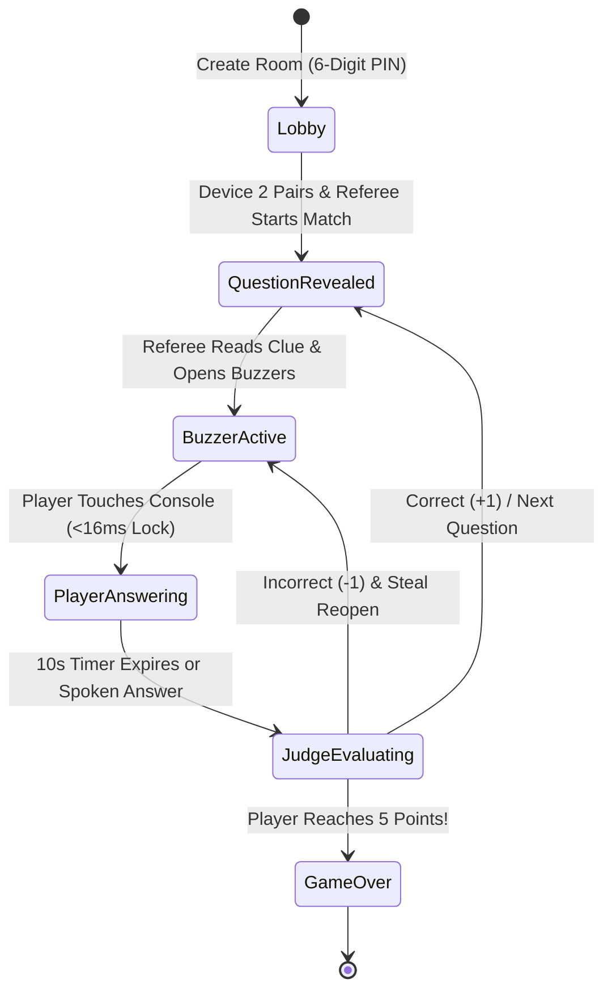

<div align="center">

# ⚡ QUIZ BUZZER
### *The Ultimate 2-Device Head-to-Head Trivia Arena*

Transform any living room, party, or classroom into a real-time, TV-style game show.  
**No extra dongles, No network latency lag. Just pure, sub-frame buzzer adrenaline.**

---

[](https://flutter.dev)
[](https://dart.dev)
[](https://supabase.com)
[]()
[]()

[🚀 Quick Start](#-quick-start) • [✨ Why 2 Devices?](#-the-2-device-breakthrough) • [🎮 Gameplay Loop](#-gameplay-loop) • [🏛️ Architecture](#-system-architecture) • [🧪 Testing](#-testing--quality)

---

</div>

## 💡 The 2-Device Breakthrough

In typical party games, everyone connects on their own phone over Wi-Fi or cellular networks. **The result? A latency lottery:**
> *Player A is on 5G, Player B is on weak Wi-Fi, and Player C loses by 180ms through pure network jitter — not reaction speed.*

**Quiz Buzzer solves this completely by decoupling the game across exactly two physical devices:**

```
                  ┌───────────────────────────────────────────────┐
                  │          DEVICE 1: REFEREE COCKPIT            │
                  │   • Full Question Prompts & Media Streams     │
                  │   • Hidden Reference Answers & Judge Notes    │
                  │   • Manual Pacing Controls & Verdict Buttons  │
                  └───────────────────────┬───────────────────────┘
                                          │
                        WebSocket Postgres Realtime Stream
                                          │
                  ┌───────────────────────▼───────────────────────┐
                  │         DEVICE 2: SHARED PLAYERS CONSOLE      │
                  │   [  PLAYER 1  ]  [  PLAYER 2  ]  [  PLAYER 3 ]  │
                  │   Electric Blue      Coral Red      Lime Green│
                  │   • Shared physical glass (Landscape Mode)   │
                  │   • Sub-frame touch arbitration (<16ms)       │
                  │   • Zero clues displayed (Anti-Peeking RLS)   │
                  └───────────────────────────────────────────────┘
```

1. **Hardware-Arbitrated Touch:** All 3 competing players share **Device 2** in landscape mode. Touches are arbitrated synchronously on the device's hardware digitizer (< 16ms) — eliminating Wi-Fi round-trip races entirely.
2. **Zero-Peeking Content Isolation:** Row-Level Security (RLS) guarantees that questions, clues, and answers are **physically inaccessible** to the Players Console.

---

## ✨ Standout Features

| Feature | Description |
| :--- | :--- |
| ⚡ **Sub-Frame Touch Capture** | Uses raw low-level OS pointer listeners (`onPointerDown`) to bypass Flutter's gesture arena for instantaneous synchronous lockouts. |
| 🛡️ **Database Content Isolation** | PostgreSQL Row-Level Security policies restrict question SELECT privileges strictly to the Referee session. |
| ⏱️ **Server-Authoritative Clock Sync** | Millisecond RTT calibration synchronizes the 10-second answer countdown across devices, immune to client clock drift. |
| 🔁 **Instant Steal Mechanic** | An incorrect answer automatically deducts a point and reopens buzzers for the remaining eligible players. |
| 🎧 **Smart Audio Ducking** | Trivia audio clue streams automatically mute the exact millisecond a player buzzes in so their voice is clearly heard. |
| 📶 **Resilient State Resync** | Backgrounding the app or temporary Wi-Fi drops automatically triggers a silent sync overlay without resetting match progress. |
| ☕ **Active Screen Wakelock** | Keeps both screens brightly illuminated throughout intense matches without OS dimming or screen sleep. |

---

## 🎮 Gameplay Loop



1. **Host Setup (Device 1):** The Referee enters player names, picks trivia categories, and taps **Generate Room PIN**.
2. **Pairing (Device 2):** The players enter the 6-digit PIN on Device 2. The console immediately locks into **landscape mode** with 3 equal-width touch columns.
3. **Clue Presentation:** The Referee reads the clue on Device 1. Device 2 shows a gentle "Listen to Referee" prompt.
4. **Buzzer Open:** Referee taps **Open Buzzers** — all three columns illuminate with vibrant pulse effects!
5. **The Buzz:** The fastest player slaps their column. Their column explodes into a bold highlight, haptics trigger, and the remaining columns dim instantly.
6. **Verdict & Steal:** The player speaks their answer aloud.
   * **Correct (+1):** Point added, next question loaded.
   * **Incorrect (-1):** 1 point deducted, player locked out, and buzzers **instantly reopen for the other 2 players to steal!**

---

## 🚀 Quick Start

### 1. Prerequisites
* [Flutter SDK](https://flutter.dev/docs/get-started/install) (`^3.13.5` or later)
* A [Supabase](https://supabase.com) project (Free tier works perfectly)

### 2. Clone & Install
```bash
git clone https://github.com/YakootShaker/casino.git
cd casino
flutter pub get
```

### 3. Setup Supabase
Run the migration scripts located in [`supabase/migrations/`](supabase/migrations/) directly in your Supabase SQL Editor:
1. `20261115000000_create_quiz_buzzer_schema.sql` *(Tables, indices, triggers & Realtime)*
2. `20261115000001_create_quiz_buzzer_rpcs.sql` *(Transactional atomic stored procedures)*
3. `20261115000002_create_quiz_buzzer_rls.sql` *(Row-Level Security & Content Isolation)*
4. `supabase/seed.sql` *(Rich sample questions: Text, Image & Audio)*

### 4. Launch the Arena
Run with your Supabase credentials:
```bash
flutter run --dart-define=SUPABASE_URL=https://your-project.supabase.co \
            --dart-define=SUPABASE_ANON_KEY=your-anon-key
```

> 💡 **Desk Testing Tip:** Run Device 1 (Referee Cockpit) in Chrome on your laptop (`flutter run -d chrome`) and Device 2 (Players Console) on your connected phone (`flutter run -d <phone-id>`).

---

## 🏛️ System Architecture

```
                    ┌─────────────────────────┐
                    │    GoRouter Navigation   │
                    └────────────┬────────────┘
                                 │
           ┌─────────────────────┴─────────────────────┐
           ▼                                           ▼
┌───────────────────────────────┐       ┌───────────────────────────────┐
│     features/referee/         │       │     features/console/         │
│  • referee_cockpit_screen     │       │  • players_console_screen     │
│  • room_setup_screen          │       │  • pin_entry_screen           │
│  • question_display_card      │       │  • buzzer_column_widget       │
│  • scoring_action_bar         │       │    (Raw Listener <16ms)       │
└──────────────┬────────────────┘       └──────────────┬────────────────┘
               │                                       │
               └───────────────────┬───────────────────┘
                                   ▼
              ┌─────────────────────────────────────────┐
              │          features/game/ (Riverpod)      │
              │  • game_state_provider (AsyncNotifier)  │
              │  • question_provider                    │
              │  • countdown_provider (100ms stream)    │
              └────────────────────┬────────────────────┘
                                   │
              ┌────────────────────┴────────────────────┐
              │             core/services/              │
              │  • game_repository (Atomic RPCs)        │
              │  • realtime_service (WebSocket)         │
              │  • clock_sync_service (RTT Offset)      │
              │  • sound_service (SFX & Audio Ducking)  │
              └─────────────────────────────────────────┘
```

---

## 📂 Project Structure

```
casino/                               ← project root (clean)
├── docs/                             ← ALL documentation
│   ├── Quiz_Buzzer_Game_Specification_AR_v2_0.docx
│   ├── spec_extracted.txt
│   ├── concepts_brief.md
│   ├── design_draft.md
│   ├── designs/
│   │   ├── quiz_buzzer_2device_architecture.md
│   │   └── SITEMAP.md
│   └── reports/                      ← generated analysis reports
│       ├── comprehension_report.md
│       ├── consolidated_review_report.md
│       ├── critic_report.md
│       ├── implementation_readiness_report.md
│       ├── intermediate_zoom_out_report.md
│       └── zoom_out_report.md
├── assets/
│   └── audio/                        ← audio buzzer sound effects
├── lib/
│   ├── app.dart                      # MaterialApp.router & Dark theme setup
│   ├── main.dart                     # Bootstrap & Supabase initialization
│   ├── core/
│   │   ├── constants/
│   │   │   ├── app_colors.dart       # Vibrant player palette definitions
│   │   │   └── app_constants.dart    # Timing parameters & game configurations
│   │   ├── services/                 # Unified core service layer
│   │   │   ├── clock_sync_service.dart # Sub-second RTT clock calibration
│   │   │   ├── sound_service.dart    # SFX buzzer & trivia audio ducking
│   │   │   └── supabase_client.dart  # Anonymous auth session manager
│   │   └── widgets/                  # Shared presentation widgets
│   │       ├── game_over_dialog.dart # Celebration modal & share sheet
│   │       └── reconnecting_overlay.dart # Non-blocking resync modal
│   ├── features/
│   │   ├── home/presentation/        # Landing screen & role selection
│   │   ├── game/                     # State management, entities & repositories
│   │   ├── console/presentation/     # 3-Player touch console & PIN entry
│   │   └── referee/presentation/     # Referee cockpit & scoring controls
│   └── routes/app_router.dart        # Declarative GoRouter routing table
├── test/
│   ├── helpers/mock_supabase.dart    # Mocktail doubles & test fixtures
│   ├── unit/                         # Unit tests (clock sync, touch arbitration)
│   ├── widget/                       # Widget tests (buzzer column widget)
│   └── integration/                  # Full game loop simulation tests
└── supabase/
    ├── migrations/                   # PostgreSQL DDL, atomic RPCs, and RLS
    └── seed.sql                      # Multi-modal trivia seed questions
```

---

## 🧪 Testing & Quality

Every commit is verified against a comprehensive testing harness:

```bash
# Run unit, widget, and integration tests
flutter test

# Run tests with code coverage analysis
flutter test --coverage

# Run static analysis
flutter analyze
```

| Suite | Status | Coverage Focus |
| :--- | :---: | :--- |
| **Clock Synchronization** | ✅ PASS | Validates RTT offsets against positive, negative, and zero time skews. |
| **Touch Arbitration** | ✅ PASS | Proves synchronous sub-frame (<16ms) lockouts and disqualified player rejection. |
| **Buzzer Column Widget** | ✅ PASS | Tests visual pulse highlights, tap rejection on lock, and answering states. |
| **Game Loop Integration** | ✅ PASS | End-to-end simulation: Lobby → Start → Buzz → Steal Reopen → Victory (5 pts). |
| **Static Analysis** | ✅ PASS | 0 errors, 0 warnings across strict Flutter linter rules. |

---

<div align="center">

Crafted with ⚡ and precision for unforgettable game nights.  
**Contributions, bug reports, and pull requests are warmly welcomed!**

</div>
