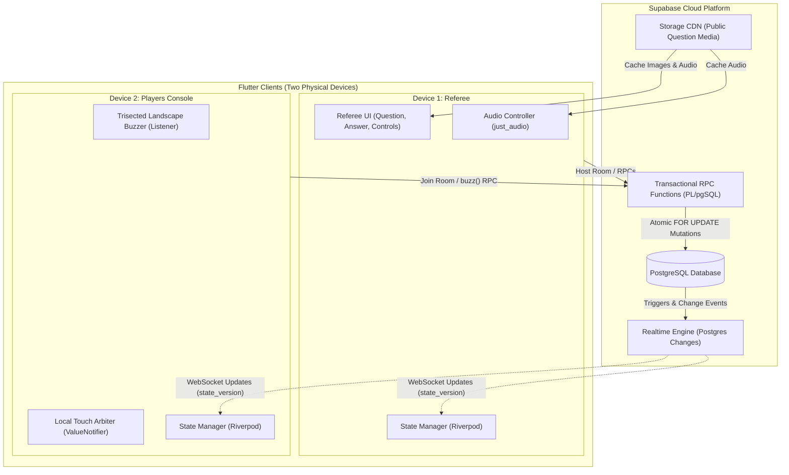

# Quiz Buzzer — 2-Device Architecture

*   **Author:** YakootShaker
*   **Status:** Draft
*   **Date:** 2026-11-15

--------------------------------------------------------------------------------

## Overview

Quiz Buzzer is a real-time multiplayer trivia buzzer application built with Flutter and Supabase. The system operates on a fixed two-device topology per room:
1. **Device 1 (Referee):** Hosts game control, question delivery (text, image, audio), reference answers, audio playback triggers, and score adjudication (+1 / −1).
2. **Device 2 (Players Console):** A single landscape-oriented smartphone or tablet shared by three players, split into three equal vertical columns acting as large tap targets. No question content is shown on this screen.

Game state, score logs, question pools, and authoritative turn deadlines reside in Supabase (Postgres, Realtime, and Storage). The Referee manually judges all spoken answers.

--------------------------------------------------------------------------------

## The Problem

Standard party trivia games and digital buzzer apps suffer from four primary failure modes:
1. **Network Latency Bias in BYOD Setup:** When each player uses their own phone over cellular or varying Wi-Fi connections, physical buzzer races are distorted by 50–200ms network round-trip discrepancies, giving unfair advantages to players on faster connections.
2. **High Setup Friction:** Requiring every player at a social gathering to install an app, configure accounts, or pair over brittle local Wi-Fi hotspots creates cognitive overhead and delays gameplay.
3. **Screen Clutter & Visual Misalignment:** Trying to display questions, images, answer options, and buzzer buttons simultaneously on small individual screens distracts players and causes accidental touches.
4. **Timer Desynchronization & Frozen State:** Client-managed countdowns freeze when devices are backgrounded or disconnect, causing dispute over answer deadlines and game stalls.

Quiz Buzzer resolves these challenges by consolidating all three players onto a single shared landscape device with local hardware touch arbitration (zero network variance between players), restricting all question content to the Referee device, and anchoring all turn deadlines to authoritative server timestamps.

--------------------------------------------------------------------------------

## Goals

*   **Fixed 2-Device Room Topology:** Exactly one Referee device and one shared Players Console per game room, paired via a 6-digit numeric PIN.
*   **Zero-Latency Hardware Touch Arbitration:** First-touch detection executed locally on the Players Console using raw pointer event listeners, immediately locking out adjacent columns before dispatching the server RPC.
*   **Server-Authoritative 10-Second Turn Deadline:** Countdown deadlines anchored to Postgres `clock_timestamp()`. Turn expiration is invariant to client app suspension or network drops.
*   **Steal Mechanic with Progressive Player Lock:** When a player answers incorrectly (−1), the buzzer reopens immediately for the remaining two players with a fresh 10-second countdown. If a second player fails, only the third player may attempt.
*   **Content Isolation:** All question text, image assets, audio controls, reference answers, and judge notes appear exclusively on the Referee screen. The Players Console shows only three reactive buzzer columns.
*   **Deterministic Role-Locked Reconnection:** Two unique cryptographic tokens (`referee_token`, `console_token`) issued upon room creation and stored in `flutter_secure_storage`. Only the two paired devices can reconnect to an in-progress session.
*   **Silent Background Re-synchronization:** When a device returns from background or restores connectivity, a non-intrusive "Reconnecting..." overlay blocks interaction while state is fetched, auto-firing turn expiration if the deadline elapsed during disconnection.
*   **Authoritative Audit Trail & Win Detection:** All score changes recorded in `score_log`. The Referee can manually adjust scores (±1). First player to reach 10 points wins.

--------------------------------------------------------------------------------

## Non-Goals

*   **No Bring-Your-Own-Device (BYOD) for Individual Players:** Expanding beyond the 2-device topology is excluded in v1.
*   **No User Accounts or Persistent Authentication:** No email, phone, or social login. Access is strictly anonymous.
*   **No Offline or Local Mesh Mode:** Supabase cloud backend is required. Peer-to-peer / hotspot architecture from v1.0 is deprecated.
*   **No In-App Question Editing:** Question authoring and asset management are conducted via external database scripts or administration tools.
*   **No Automated Speech or Audio Recognition:** All spoken responses are evaluated manually by the Referee.
*   **No Copyrighted Media:** Only public-domain and royalty-free images and audio clips are utilized for v1.
*   **No Server-Side Background Cron / Daemon:** Turn expiration and state progression rely on client-driven idempotent RPCs with server time validation.

--------------------------------------------------------------------------------

## Open Questions

*   *None.* All architectural decisions (D1–D7) were locked and approved during the ideation phase.

--------------------------------------------------------------------------------

## Critical User Journeys (CUJs)

### CUJ 1: Room Creation, Pairing & Role Lock

*   **Given**: Referee device and Players Console device have the application installed and have internet access.
*   **When**:
    1. Referee opens the app, selects "Host Game", receives a 6-digit PIN, and enters names for Player 1, Player 2, and Player 3.
    2. Players Console opens the app, enters the 6-digit PIN, and taps "Join as Players".
*   **Then**:
    1. Server binds `referee_uid` and `console_uid` to the room row, returning SHA-256 validated session tokens stored in `flutter_secure_storage`.
    2. The room transitions to `lobby`.
    3. Any third device attempting to join with the same PIN is rejected with `room_full`.

### CUJ 2: Normal Question Cycle & Immediate Buzz

*   **Given**: Room is in `lobby`. Referee selects question categories and taps "Start Game".
*   **When**:
    1. Server transitions to `question_active` and draws an unused question.
    2. Question text/media appears on Referee screen.
    3. Players Console displays three active colored buzzer columns.
    4. Player 1 touches Column 1.
*   **Then**:
    1. Players Console triggers instant heavy haptic feedback, plays local SFX, and visually locks Columns 2 and 3 within the local UI thread.
    2. Players Console calls `buzz(room_id, 0)`.
    3. Server verifies `phase = 'question_active'`, sets `phase = 'buzzer_active'`, `active_player_index = 0`, and `buzz_expires_at = clock_timestamp() + 10s`.
    4. Both devices receive the state update via Realtime and display Player 1's active 10-second countdown.

### CUJ 3: Wrong Answer, Score Deduction & Steal Reopen

*   **Given**: Player 1 has buzzed in and the countdown is running. Player 1 gives an incorrect verbal answer.
*   **When**: Referee taps "Incorrect (−1)".
*   **Then**:
    1. Server deducts 1 point from Player 1 in `rooms.player_scores`, records the event in `score_log`, and appends `0` to `locked_player_indices`.
    2. Because remaining players exist (`locked_player_indices` length < 3), server transitions phase back to `question_active` with `active_player_index = NULL` and `buzz_expires_at = NULL`.
    3. Players Console receives update: Column 1 remains visually disabled/dimmed; Columns 2 and 3 reopen for buzz.
    4. Player 2 touches Column 2: a fresh 10-second countdown begins for Player 2.

### CUJ 4: Device Suspension & Disconnection Recovery

*   **Given**: Player 2 has buzzed in. 6 seconds remain on the countdown. The Players Console is backgrounded or network is interrupted.
*   **When**: Players Console is brought back to the foreground 15 seconds later.
*   **Then**:
    1. The app immediately displays a full-screen "Reconnecting..." overlay.
    2. App fetches current state via REST API and calculates that `clock_timestamp() > buzz_expires_at`.
    3. App calls `expire_turn(room_id)`.
    4. Server atomically deducts 1 point from Player 2, logs timeout event, appends `1` to `locked_player_indices`, and resets active turn.
    5. App removes the "Reconnecting..." overlay and resumes display in sync with current server state.

### CUJ 5: Match Conclusion & Victory State

*   **Given**: Player 3 has 9 points. Room is in `buzzer_active` with Player 3 answering.
*   **When**: Referee taps "Correct (+1)".
*   **Then**:
    1. Server atomically increments Player 3's score to 10.
    2. Server detects `player_scores[2] >= 10`, sets `phase = 'game_over'`, and marks `winner_player_index = 2`.
    3. Referee and Players Console transition to celebration screen displaying final scores, question statistics, and shareable match summary.


--------------------------------------------------------------------------------

## Technical Plan (Architecture)

### 1. High-Level System Architecture

Quiz Buzzer is structured as a dual-role distributed system communicating through Supabase serverless infrastructure:



### 2. State Machine & Lifecycle

The room state advances through five formally defined phases:

```
[lobby] ───────────► [question_active] ───────────► [buzzer_active]
                          ▲                                │
                          │ (Steal or Wrong Answer)        │ (Correct Answer / Win Check)
                          │ (Remaining Players > 0)        ▼
                          ├───────────────────────── [judge_evaluating]
                          │                                │
                          ▼ (All 3 Players Locked          ▼ (Player Score >= 10)
                          │  or Question Skipped)     [game_over]
                          └──► [question_active]
```

#### Detailed Phase Transitions:
*   `lobby`: Room created, waiting for Console device to join. Referee assigns player names and selects categories.
*   `question_active`: Active question selected. Referee screen displays question content and reference answers. On Players Console, all columns not present in `locked_player_indices` are active and listening for touch events.
*   `buzzer_active`: A player has successfully registered a buzz. The active column pulses; non-active columns are dimmed. Authoritative 10-second countdown runs (`buzz_expires_at`).
*   `judge_evaluating`: Optional sub-phase or transient state while the Referee enters a verdict, or directly resolved inside `judge_mark()` / `expire_turn()`.
*   `game_over`: A player reaches 10 points or all categories are exhausted. Buzzers locked permanently. Final score cards and summary card displayed.

### 3. Data Model & Database Schema

The database design enforces relational consistency, cascading cleanups, and atomic concurrency guards:

```sql
-- Extensions
CREATE EXTENSION IF NOT EXISTS "pgcrypto";

-- 1. Rooms Table
CREATE TABLE rooms (
  id                  UUID PRIMARY KEY DEFAULT gen_random_uuid(),
  room_pin            VARCHAR(6) NOT NULL UNIQUE,
  referee_token_hash  TEXT NOT NULL,
  console_token_hash  TEXT,
  referee_uid         UUID REFERENCES auth.users(id),
  console_uid         UUID REFERENCES auth.users(id),
  player_names        TEXT[] NOT NULL DEFAULT ARRAY['Player 1', 'Player 2', 'Player 3'],
  player_scores       INT[] NOT NULL DEFAULT ARRAY[0, 0, 0],
  selected_categories TEXT[] NOT NULL DEFAULT ARRAY[]::TEXT[],
  created_at          TIMESTAMPTZ NOT NULL DEFAULT clock_timestamp(),
  room_expires_at     TIMESTAMPTZ NOT NULL DEFAULT (clock_timestamp() + INTERVAL '4 hours')
);

-- 2. Questions Bank
CREATE TABLE questions (
  id               UUID PRIMARY KEY DEFAULT gen_random_uuid(),
  category         TEXT NOT NULL,
  question_type    TEXT NOT NULL CHECK (question_type IN ('text', 'image', 'audio')),
  question_text    TEXT,
  image_url        TEXT,
  audio_url        TEXT,
  reference_answer TEXT NOT NULL,
  judge_notes      TEXT,
  difficulty       INT NOT NULL DEFAULT 1,
  created_at       TIMESTAMPTZ NOT NULL DEFAULT clock_timestamp()
);

-- 3. Room-Question Join Table (Prevents Question Repetition)
CREATE TABLE room_questions (
  room_id     UUID NOT NULL REFERENCES rooms(id) ON DELETE CASCADE,
  question_id UUID NOT NULL REFERENCES questions(id) ON DELETE CASCADE,
  asked_at    TIMESTAMPTZ NOT NULL DEFAULT clock_timestamp(),
  PRIMARY KEY (room_id, question_id)
);

-- 4. Game States Table (1:1 with Rooms)
CREATE TABLE game_states (
  room_id               UUID PRIMARY KEY REFERENCES rooms(id) ON DELETE CASCADE,
  phase                 TEXT NOT NULL DEFAULT 'lobby' 
                        CHECK (phase IN ('lobby', 'question_active', 'buzzer_active', 'game_over')),
  state_version         BIGINT NOT NULL DEFAULT 0,
  current_question_id   UUID REFERENCES questions(id),
  active_player_index   INT CHECK (active_player_index IN (0, 1, 2)),
  locked_player_indices INT[] NOT NULL DEFAULT ARRAY[]::INT[],
  buzz_expires_at       TIMESTAMPTZ,
  winner_player_index   INT CHECK (winner_player_index IN (0, 1, 2)),
  updated_at            TIMESTAMPTZ NOT NULL DEFAULT clock_timestamp()
);

-- 5. Score Event Audit Log
CREATE TABLE score_log (
  id           BIGSERIAL PRIMARY KEY,
  room_id      UUID NOT NULL REFERENCES rooms(id) ON DELETE CASCADE,
  question_id  UUID REFERENCES questions(id),
  player_index INT NOT NULL CHECK (player_index IN (0, 1, 2)),
  delta        INT NOT NULL,
  reason       TEXT NOT NULL CHECK (reason IN ('correct', 'incorrect', 'timeout', 'manual_adjust')),
  created_at   TIMESTAMPTZ NOT NULL DEFAULT clock_timestamp()
);

-- Indexes for Fast Lookups
CREATE INDEX idx_rooms_pin ON rooms(room_pin);
CREATE INDEX idx_room_questions_room ON room_questions(room_id);
CREATE INDEX idx_questions_category ON questions(category);
CREATE INDEX idx_score_log_room ON score_log(room_id);

-- Auto-Increment Trigger for state_version and updated_at
CREATE OR REPLACE FUNCTION increment_state_version()
RETURNS TRIGGER LANGUAGE plpgsql AS $$
BEGIN
  NEW.state_version := OLD.state_version + 1;
  NEW.updated_at    := clock_timestamp();
  RETURN NEW;
END;
$$;

CREATE TRIGGER trg_state_version
  BEFORE UPDATE ON game_states
  FOR EACH ROW EXECUTE FUNCTION increment_state_version();
```

### 4. Authoritative Server RPCs

All mutations are conducted via transactional PL/pgSQL functions using `SECURITY DEFINER` and row-level `FOR UPDATE` locking:

#### 4.1 Room Creation (`create_room`)
```sql
CREATE OR REPLACE FUNCTION create_room(
  p_categories TEXT[],
  p_player_names TEXT[]
)
RETURNS JSONB LANGUAGE plpgsql SECURITY DEFINER AS $$
DECLARE
  v_room_id UUID;
  v_pin VARCHAR(6);
  v_ref_raw_token TEXT;
  v_ref_token_hash TEXT;
BEGIN
  -- Generate unique 6-digit numeric PIN
  LOOP
    v_pin := lpad(floor(random() * 1000000)::TEXT, 6, '0');
    EXIT WHEN NOT EXISTS (
      SELECT 1 FROM rooms WHERE room_pin = v_pin AND room_expires_at > clock_timestamp()
    );
  END LOOP;

  v_ref_raw_token := encode(gen_random_bytes(32), 'hex');
  v_ref_token_hash := encode(digest(v_ref_raw_token, 'sha256'), 'hex');

  INSERT INTO rooms (
    room_pin, referee_token_hash, referee_uid, player_names, selected_categories
  ) VALUES (
    v_pin, v_ref_token_hash, auth.uid(), p_player_names, p_categories
  ) RETURNING id INTO v_room_id;

  INSERT INTO game_states (room_id, phase)
  VALUES (v_room_id, 'lobby');

  RETURN jsonb_build_object(
    'room_id', v_room_id,
    'room_pin', v_pin,
    'referee_token', v_ref_raw_token
  );
END;
$$;
```

#### 4.2 Room Join (`join_room`)
```sql
CREATE OR REPLACE FUNCTION join_room(
  p_pin VARCHAR(6),
  p_role TEXT,
  p_token TEXT DEFAULT NULL
)
RETURNS JSONB LANGUAGE plpgsql SECURITY DEFINER AS $$
DECLARE
  v_room rooms;
  v_console_raw_token TEXT;
  v_console_token_hash TEXT;
BEGIN
  SELECT * INTO v_room FROM rooms 
  WHERE room_pin = p_pin AND room_expires_at > clock_timestamp();

  IF NOT FOUND THEN
    RETURN jsonb_build_object('success', false, 'error', 'ROOM_NOT_FOUND');
  END IF;

  -- Reconnection path with existing token
  IF p_token IS NOT NULL THEN
    IF p_role = 'referee' AND v_room.referee_token_hash = encode(digest(p_token, 'sha256'), 'hex') THEN
      UPDATE rooms SET referee_uid = auth.uid() WHERE id = v_room.id;
      RETURN jsonb_build_object('success', true, 'room_id', v_room.id, 'role', 'referee');
    ELSIF p_role = 'console' AND v_room.console_token_hash = encode(digest(p_token, 'sha256'), 'hex') THEN
      UPDATE rooms SET console_uid = auth.uid() WHERE id = v_room.id;
      RETURN jsonb_build_object('success', true, 'room_id', v_room.id, 'role', 'console');
    ELSE
      RETURN jsonb_build_object('success', false, 'error', 'INVALID_TOKEN');
    END IF;
  END IF;

  -- Initial Console Join
  IF p_role = 'console' THEN
    IF v_room.console_token_hash IS NOT NULL THEN
      RETURN jsonb_build_object('success', false, 'error', 'ROOM_ALREADY_CLAIMED');
    END IF;

    v_console_raw_token := encode(gen_random_bytes(32), 'hex');
    v_console_token_hash := encode(digest(v_console_raw_token, 'sha256'), 'hex');

    UPDATE rooms SET
      console_token_hash = v_console_token_hash,
      console_uid = auth.uid()
    WHERE id = v_room.id;

    RETURN jsonb_build_object(
      'success', true,
      'room_id', v_room.id,
      'role', 'console',
      'console_token', v_console_raw_token
    );
  END IF;

  RETURN jsonb_build_object('success', false, 'error', 'UNAUTHORIZED_ROLE');
END;
$$;
```

#### 4.3 Atomic Buzzer Press (`buzz`)
```sql
CREATE OR REPLACE FUNCTION buzz(p_room_id UUID, p_player_index INT)
RETURNS JSONB LANGUAGE plpgsql SECURITY DEFINER AS $$
DECLARE
  v_state game_states;
BEGIN
  SELECT * INTO v_state FROM game_states
  WHERE room_id = p_room_id FOR UPDATE;

  IF v_state.phase <> 'question_active' THEN
    RETURN jsonb_build_object('accepted', false, 'reason', 'WRONG_PHASE');
  END IF;

  IF p_player_index = ANY(v_state.locked_player_indices) THEN
    RETURN jsonb_build_object('accepted', false, 'reason', 'PLAYER_LOCKED');
  END IF;

  UPDATE game_states SET
    phase               = 'buzzer_active',
    active_player_index = p_player_index,
    buzz_expires_at     = clock_timestamp() + INTERVAL '10 seconds'
  WHERE room_id = p_room_id;

  RETURN jsonb_build_object(
    'accepted', true,
    'active_player', p_player_index,
    'expires_at', (clock_timestamp() + INTERVAL '10 seconds')
  );
END;
$$;
```

#### 4.4 Judgment Evaluation (`judge_mark`)
```sql
CREATE OR REPLACE FUNCTION judge_mark(
  p_room_id UUID, 
  p_verdict TEXT -- 'correct' or 'incorrect'
)
RETURNS JSONB LANGUAGE plpgsql SECURITY DEFINER AS $$
DECLARE
  v_state game_states;
  v_room rooms;
  v_player INT;
  v_scores INT[];
  v_locked INT[];
  v_new_q UUID;
BEGIN
  SELECT * INTO v_state FROM game_states WHERE room_id = p_room_id FOR UPDATE;
  SELECT * INTO v_room FROM rooms WHERE id = p_room_id FOR UPDATE;

  IF v_state.phase <> 'buzzer_active' THEN
    RETURN jsonb_build_object('success', false, 'reason', 'NOT_IN_BUZZER_ACTIVE');
  END IF;

  v_player := v_state.active_player_index;
  v_scores := v_room.player_scores;

  IF p_verdict = 'correct' THEN
    -- Award +1 Point
    v_scores[v_player + 1] := v_scores[v_player + 1] + 1;
    UPDATE rooms SET player_scores = v_scores WHERE id = p_room_id;

    INSERT INTO score_log (room_id, question_id, player_index, delta, reason)
    VALUES (p_room_id, v_state.current_question_id, v_player, 1, 'correct');

    -- Win Condition Check (>= 10 points)
    IF v_scores[v_player + 1] >= 10 THEN
      UPDATE game_states SET
        phase = 'game_over',
        winner_player_index = v_player,
        active_player_index = NULL,
        buzz_expires_at = NULL
      WHERE room_id = p_room_id;

      RETURN jsonb_build_object('success', true, 'outcome', 'GAME_OVER', 'winner', v_player);
    END IF;

    -- Pick Next Question
    SELECT q.id INTO v_new_q FROM questions q
    WHERE q.category = ANY(v_room.selected_categories)
      AND q.id NOT IN (SELECT question_id FROM room_questions WHERE room_id = p_room_id)
    ORDER BY random() LIMIT 1;

    IF v_new_q IS NULL THEN
      UPDATE game_states SET phase = 'game_over', active_player_index = NULL, buzz_expires_at = NULL WHERE room_id = p_room_id;
      RETURN jsonb_build_object('success', true, 'outcome', 'QUESTIONS_EXHAUSTED');
    END IF;

    INSERT INTO room_questions (room_id, question_id) VALUES (p_room_id, v_new_q);

    UPDATE game_states SET
      phase = 'question_active',
      current_question_id = v_new_q,
      active_player_index = NULL,
      locked_player_indices = ARRAY[]::INT[],
      buzz_expires_at = NULL
    WHERE room_id = p_room_id;

    RETURN jsonb_build_object('success', true, 'outcome', 'NEXT_QUESTION');

  ELSIF p_verdict = 'incorrect' THEN
    -- Deduct -1 Point
    v_scores[v_player + 1] := v_scores[v_player + 1] - 1;
    UPDATE rooms SET player_scores = v_scores WHERE id = p_room_id;

    INSERT INTO score_log (room_id, question_id, player_index, delta, reason)
    VALUES (p_room_id, v_state.current_question_id, v_player, -1, 'incorrect');

    v_locked := array_append(v_state.locked_player_indices, v_player);

    -- If all 3 players locked, advance to next question
    IF cardinality(v_locked) >= 3 THEN
      SELECT q.id INTO v_new_q FROM questions q
      WHERE q.category = ANY(v_room.selected_categories)
        AND q.id NOT IN (SELECT question_id FROM room_questions WHERE room_id = p_room_id)
      ORDER BY random() LIMIT 1;

      IF v_new_q IS NULL THEN
        UPDATE game_states SET phase = 'game_over', active_player_index = NULL, buzz_expires_at = NULL WHERE room_id = p_room_id;
        RETURN jsonb_build_object('success', true, 'outcome', 'QUESTIONS_EXHAUSTED');
      END IF;

      INSERT INTO room_questions (room_id, question_id) VALUES (p_room_id, v_new_q);

      UPDATE game_states SET
        phase = 'question_active',
        current_question_id = v_new_q,
        active_player_index = NULL,
        locked_player_indices = ARRAY[]::INT[],
        buzz_expires_at = NULL
      WHERE room_id = p_room_id;

      RETURN jsonb_build_object('success', true, 'outcome', 'ALL_LOCKED_NEXT_QUESTION');
    ELSE
      -- Reopen buzzer for remaining players
      UPDATE game_states SET
        phase = 'question_active',
        active_player_index = NULL,
        locked_player_indices = v_locked,
        buzz_expires_at = NULL
      WHERE room_id = p_room_id;

      RETURN jsonb_build_object('success', true, 'outcome', 'STEAL_REOPENED', 'locked', v_locked);
    END IF;
  END IF;

  RETURN jsonb_build_object('success', false, 'reason', 'INVALID_VERDICT');
END;
$$;
```

#### 4.5 Idempotent Turn Expiration (`expire_turn`)
```sql
CREATE OR REPLACE FUNCTION expire_turn(p_room_id UUID)
RETURNS JSONB LANGUAGE plpgsql SECURITY DEFINER AS $$
DECLARE
  v_state game_states;
  v_room rooms;
  v_player INT;
  v_scores INT[];
  v_locked INT[];
  v_new_q UUID;
BEGIN
  SELECT * INTO v_state FROM game_states WHERE room_id = p_room_id FOR UPDATE;

  -- Guard: Only act if active countdown has strictly expired
  IF v_state.phase <> 'buzzer_active' OR v_state.buzz_expires_at > clock_timestamp() THEN
    RETURN jsonb_build_object('transitioned', false, 'reason', 'NOT_EXPIRED_OR_WRONG_PHASE');
  END IF;

  SELECT * INTO v_room FROM rooms WHERE id = p_room_id FOR UPDATE;
  v_player := v_state.active_player_index;
  v_scores := v_room.player_scores;

  -- Apply -1 Penalty for Timeout
  v_scores[v_player + 1] := v_scores[v_player + 1] - 1;
  UPDATE rooms SET player_scores = v_scores WHERE id = p_room_id;

  INSERT INTO score_log (room_id, question_id, player_index, delta, reason)
  VALUES (p_room_id, v_state.current_question_id, v_player, -1, 'timeout');

  v_locked := array_append(v_state.locked_player_indices, v_player);

  IF cardinality(v_locked) >= 3 THEN
    SELECT q.id INTO v_new_q FROM questions q
    WHERE q.category = ANY(v_room.selected_categories)
      AND q.id NOT IN (SELECT question_id FROM room_questions WHERE room_id = p_room_id)
    ORDER BY random() LIMIT 1;

    IF v_new_q IS NULL THEN
      UPDATE game_states SET phase = 'game_over', active_player_index = NULL, buzz_expires_at = NULL WHERE room_id = p_room_id;
      RETURN jsonb_build_object('transitioned', true, 'outcome', 'QUESTIONS_EXHAUSTED');
    END IF;

    INSERT INTO room_questions (room_id, question_id) VALUES (p_room_id, v_new_q);

    UPDATE game_states SET
      phase = 'question_active',
      current_question_id = v_new_q,
      active_player_index = NULL,
      locked_player_indices = ARRAY[]::INT[],
      buzz_expires_at = NULL
    WHERE room_id = p_room_id;

    RETURN jsonb_build_object('transitioned', true, 'outcome', 'NEXT_QUESTION');
  ELSE
    UPDATE game_states SET
      phase = 'question_active',
      active_player_index = NULL,
      locked_player_indices = v_locked,
      buzz_expires_at = NULL
    WHERE room_id = p_room_id;

    RETURN jsonb_build_object('transitioned', true, 'outcome', 'STEAL_REOPENED', 'locked', v_locked);
  END IF;
END;
$$;
```

#### 4.6 Manual Score Adjustment (`adjust_score`)
```sql
CREATE OR REPLACE FUNCTION adjust_score(
  p_room_id UUID, 
  p_player_index INT, 
  p_delta INT
)
RETURNS JSONB LANGUAGE plpgsql SECURITY DEFINER AS $$
DECLARE
  v_room rooms;
  v_scores INT[];
BEGIN
  SELECT * INTO v_room FROM rooms WHERE id = p_room_id FOR UPDATE;
  v_scores := v_room.player_scores;
  v_scores[p_player_index + 1] := v_scores[p_player_index + 1] + p_delta;

  UPDATE rooms SET player_scores = v_scores WHERE id = p_room_id;

  INSERT INTO score_log (room_id, player_index, delta, reason)
  VALUES (p_room_id, p_player_index, p_delta, 'manual_adjust');

  -- Check if adjustment triggered victory
  IF v_scores[p_player_index + 1] >= 10 THEN
    UPDATE game_states SET phase = 'game_over', winner_player_index = p_player_index WHERE room_id = p_room_id;
  END IF;

  RETURN jsonb_build_object('success', true, 'player_scores', v_scores);
END;
$$;
```

#### 4.7 Question Skipping (`skip_question`)
```sql
CREATE OR REPLACE FUNCTION skip_question(p_room_id UUID)
RETURNS JSONB LANGUAGE plpgsql SECURITY DEFINER AS $$
DECLARE
  v_room rooms;
  v_new_q UUID;
BEGIN
  SELECT * INTO v_room FROM rooms WHERE id = p_room_id FOR UPDATE;

  SELECT q.id INTO v_new_q FROM questions q
  WHERE q.category = ANY(v_room.selected_categories)
    AND q.id NOT IN (SELECT question_id FROM room_questions WHERE room_id = p_room_id)
  ORDER BY random() LIMIT 1;

  IF v_new_q IS NULL THEN
    UPDATE game_states SET phase = 'game_over', active_player_index = NULL, buzz_expires_at = NULL WHERE room_id = p_room_id;
    RETURN jsonb_build_object('success', true, 'outcome', 'QUESTIONS_EXHAUSTED');
  END IF;

  INSERT INTO room_questions (room_id, question_id) VALUES (p_room_id, v_new_q);

  UPDATE game_states SET
    phase = 'question_active',
    current_question_id = v_new_q,
    active_player_index = NULL,
    locked_player_indices = ARRAY[]::INT[],
    buzz_expires_at = NULL
  WHERE room_id = p_room_id;

  RETURN jsonb_build_object('success', true, 'outcome', 'QUESTION_SKIPPED');
END;
$$;
```

### 5. Client Architecture & Implementation Subsystems

#### 5.1 Touch Arbitration Engine (Players Console)
*   **Hardware Interface**: Utilizes Flutter's raw `Listener(onPointerDown: ...)` with `HitTestBehavior.opaque` across three expanded flex columns.
*   **Local UI Lockout**: On `PointerDownEvent`, the local `ValueNotifier<int?> localActivePlayer` is set synchronously in the UI frame before entering the asynchronous event loop. Any touch on remaining columns while `localActivePlayer.value != null` is discarded at 0ms latency.
*   **Tactile Confirmation**: `HapticFeedback.heavyImpact()` and a local audio asset `buzz.mp3` fire instantly in the pointer callback.
*   **RPC Dispatch**: The asynchronous call `supabase.rpc('buzz', ...)` is fired in the background. If the server rejects the buzz (e.g. wrong phase), `localActivePlayer.value` resets.

#### 5.2 Clock-Offset Correction & Timer Synchronization
*   On room join/reconnect, the client records the delta between device UTC time and the Supabase HTTP response `Date` header:
    $$\Delta_{\text{clock}} = T_{\text{server}} - T_{\text{local}}$$
*   The reactive countdown provider derives remaining time as:
    $$t_{\text{remaining}} = \max\left(0, \left(T_{\text{buzz\_expires\_at}} + \Delta_{\text{clock}}\right) - T_{\text{local}}\right)$$
*   This ensures budget Android devices with skewed local clocks display exact millisecond-accurate countdowns matching server thresholds.

#### 5.3 Silent Reconnection & Zombie State Sweeping
*   **Lifecycle Listener**: Client monitors `AppLifecycleState.resumed`.
*   **Reconnection Overlay**: On resume, an immediate high-priority modal overlay ("Reconnecting...") blocks touches.
*   **State Refetch & Zombie Check**: The client issues a REST fetch for `game_states`. If `phase == 'buzzer_active'` and `buzz_expires_at <= clock_timestamp()`, the client immediately fires `expire_turn()`.
*   **Overlay Tear-Down**: Once fresh state is applied to Riverpod, the overlay dissolves with a 150ms fade.

#### 5.4 Audio Stream & Asset Pre-Caching Pipeline
*   **Player Package**: Implemented via `just_audio` using `AudioPlayer`.
*   **Pre-Caching Hook**: When `game_states.phase` transitions to `question_active` with `question_type == 'audio'`, the Referee client immediately executes `await player.setUrl(audioUrl); await player.load();` while the card is rendering.
*   **Playback Trigger**: Playback begins instantaneously when the Referee taps the Play button, eliminating streaming latency during gameplay.

### 6. Row-Level Security (RLS) & Authorization

*   **Anonymous Auth**: Every client signs in anonymously via `supabase.auth.signInAnonymously()`, acquiring an individual `auth.uid()`.
*   **Table Access Policies**:
    *   `rooms`: Read permitted if `auth.uid() IN (referee_uid, console_uid)`. Insert allowed for new rooms. Direct client updates disabled; all updates restricted to RPC functions.
    *   `game_states`: Publicly selectable by room members; updates restricted to `SECURITY DEFINER` RPCs.
    *   `questions`: Selectable by `auth.uid() = referee_uid`. Only public question metadata (excluding `reference_answer` and `judge_notes`) accessible to Console device through a Postgres View (`v_console_questions`).
    *   `score_log`: Selectable by room members for summary generation.

### 7. Storage Bucket Topology

```
supabase/storage/
  └── questions/               (Bucket: public read)
        ├── images/
        │     └── {question_uuid}.jpg   (Optimized JPEG, <= 300 KB, <= 1080px)
        └── audio/
              └── {question_uuid}.mp3   (CBR MP3, <= 10s duration)
```
Write permissions to the `questions` storage bucket are locked to the Supabase Service Role Key for administrative bulk uploads.


--------------------------------------------------------------------------------

## Alternatives Considered

### Alternative 1: One Phone Per Player (BYOD Model)

*   **Pros**:
    *   Players hold their own devices naturally without physical crowding.
    *   Familiar pattern matching mass-market party games (e.g., Kahoot, Jackbox).
*   **Cons**:
    *   **Network Latency Skew**: Inevitable 50–200ms round-trip latency discrepancies between cellular carriers and Wi-Fi networks distort buzzer race fairness.
    *   **Setup Friction**: Requires every participant at a gathering to download, install, and configure the application.
    *   **Resource Consumption**: Quadruples Supabase Realtime concurrent connection count per room.
*   **Reason for Rejection**: Rejected by author: Physical setup simplicity and total elimination of network latency races through local hardware touch arbitration outweigh individual device convenience.

### Alternative 2: Local Hotspot & Wi-Fi Direct Mesh (v1.0 Architecture)

*   **Pros**:
    *   Zero cloud infrastructure costs.
    *   Operational in venues without internet connectivity.
*   **Cons**:
    *   Modern Android (API 29+) and iOS sandbox restrictions heavily penalize programmatic local Wi-Fi hotspot management.
    *   High connection friction requiring manual SSID switching and IP configuration.
    *   If the host phone receives a phone call or enters background, the local server process terminates abruptly.
*   **Reason for Rejection**: Rejected by author: High pairing friction and mobile OS permission boundaries make local mesh fragile. Supabase cloud backend provides reliable state persistence and zero local configuration.

### Alternative 3: Server-Side Active Timer Daemon (`pg_cron` / Edge Function Webhooks)

*   **Pros**:
    *   Guarantees turn expiration even if both devices completely lose power or disconnect simultaneously.
    *   Zero reliance on client pump calls.
*   **Cons**:
    *   Requires configuring, funding, and monitoring external scheduled worker daemons or Postgres extensions (`pg_cron`) for casual, low-frequency sessions.
    *   Increases database write overhead with frequent polling jobs.
*   **Reason for Rejection**: Rejected by author: In a 2-device local gathering, both devices disconnecting simultaneously during a 10-second countdown is an extreme edge case. The client-driven `expire_turn` RPC guarded by `FOR UPDATE` and clock-validated reconnect sweep completely solves the problem with zero added infrastructure.

### Alternative 4: Client-Reported Hardware Timestamps

*   **Pros**:
    *   Clients report local touch timestamps directly to server for chronological sorting.
*   **Cons**:
    *   Trivially exploited by altering system clock settings.
    *   Clock drift on budget mobile hardware makes millisecond ordering across devices unreliable.
*   **Reason for Rejection**: Rejected by author: Server `clock_timestamp()` must remain the sole authoritative arbiter of game deadlines.

### Alternative 5: Flutter `GestureDetector` for Buzzer Columns

*   **Pros**:
    *   High-level abstraction with built-in tap cancellation and semantic recognition.
*   **Cons**:
    *   Flutter's Gesture Arena introduces frame-level resolution delays to disambiguate taps from drags or multi-touch gestures.
    *   Can drop or delay near-simultaneous multi-finger touches across column boundaries.
*   **Reason for Rejection**: Rejected by author: Raw `Listener` with `onPointerDown` and `HitTestBehavior.opaque` captures immediate hardware touch events at the lowest layer of the Flutter engine, executing local lockouts at 0ms latency.

### Alternative 6: Portrait Orientation for Players Console

*   **Pros**:
    *   Standard vertical device holding posture.
*   **Cons**:
    *   Dividing a standard portrait screen into 3 horizontal bands creates narrow vertical hit targets where player palms collide.
    *   Dividing vertically in portrait results in extremely thin vertical slivers (e.g., ~22mm wide).
*   **Reason for Rejection**: Rejected by author: Landscape orientation provides three wide vertical columns across the full screen height, offering ergonomic separation for three adult hands.

--------------------------------------------------------------------------------

## Non-Functional Requirements

### Security & Privacy
*   **Anonymous Operation**: Zero Personally Identifiable Information (PII) is stored. Authentication uses anonymous tokens.
*   **Token Protection**: Role tokens (`referee_token`, `console_token`) are 256-bit cryptographically random strings hashed via SHA-256 in Postgres. Raw tokens are stored exclusively in platform-native secure storage (`EncryptedSharedPreferences` on Android, Keychain with `synchronizable: false` on iOS).
*   **Row-Level Security (RLS)**: Enforces table isolation so only paired device UIDs can query room state. Reference answers are inaccessible to the console device.

### Performance & Latency
*   **Local Touch Response**: Pointer down to visual color change and haptic trigger must complete within a single UI frame (< 16ms).
*   **RPC Execution**: Server RPCs (`buzz`, `judge_mark`, `expire_turn`) must complete execution within < 100ms under standard network conditions.
*   **Asset Footprint**: Images compressed to <= 300 KB; audio clips compressed to <= 10s MP3 (< 160 KB) to ensure rapid loading on cellular connections.

### Operational Resilience
*   **Automatic Room Expiration**: Unused or abandoned rooms expire automatically after 4 hours (`room_expires_at`).
*   **Idempotent State Mutations**: All RPCs tolerate duplicate delivery from flaky connections without corrupting scores or state versions.

--------------------------------------------------------------------------------

## Future Improvements

*   **Tournament & League Mode**: Multi-round tournaments with bracket tracking and cumulative scoring across multiple games.
*   **Host-Driven Custom Questions**: Local question creator allowing hosts to input custom trivia packs for corporate or family events.
*   **Web Console for Players**: Flutter Web deployment allowing players to use a laptop or smart TV as the shared buzzer console.


--------------------------------------------------------------------------------

## Detailed Implementation Plan

### Target Files to Create/Modify

#### 1. Configuration & Project Initialization

*   **`pubspec.yaml`** (`Modify`):
    *   **Type / Scope**: Flutter Project Dependency Manifest.
    *   **Proposed Changes**: Add dependencies: `flutter_riverpod`, `supabase_flutter`, `go_router`, `flutter_secure_storage`, `just_audio`, `cached_network_image`, `share_plus`, `flutter_animate`, `google_fonts`. Configure asset folders for local audio (`assets/audio/buzz.mp3`).
    *   **Rationale**: Establishes all required third-party libraries for state management, networking, secure storage, and media handling.

*   **`analysis_options.yaml`** (`Modify`):
    *   **Type / Scope**: Static Analysis Configuration.
    *   **Proposed Changes**: Enable strict mode (`strict-casts`, `strict-inference`, `strict-raw-types`) and Flutter lints.
    *   **Rationale**: Prevents runtime type bugs in polymorphic RPC response decoding and state models.

*   **`README.md`** (`Modify`):
    *   **Type / Scope**: Developer Documentation.
    *   **Proposed Changes**: Document architecture, 2-device topology, Supabase setup steps, and local testing instructions.
    *   **Rationale**: Provides onboarding instructions and architectural context for contributors.

#### 2. Backend Migrations & Database Scripts

*   **`supabase/migrations/20261115000000_create_quiz_buzzer_schema.sql`** (`Create`):
    *   **Type / Scope**: PostgreSQL DDL Migration.
    *   **Proposed Changes**: Creates tables: `rooms`, `game_states`, `questions`, `room_questions`, `score_log`. Configures foreign keys, cascades, indexes, and the auto-incrementing `trg_state_version` trigger.
    *   **Rationale**: Establishes the core relational schema supporting atomic transitions and room lifecycle.

*   **`supabase/migrations/20261115000001_create_quiz_buzzer_rpcs.sql`** (`Create`):
    *   **Type / Scope**: PL/pgSQL Stored Procedures.
    *   **Proposed Changes**: Implements `create_room`, `join_room`, `buzz`, `judge_mark`, `expire_turn`, `adjust_score`, and `skip_question` with `SECURITY DEFINER` and `FOR UPDATE` concurrency locks.
    *   **Rationale**: Encapsulates all transactional game logic on the server to prevent client-side race conditions.

*   **`supabase/migrations/20261115000002_create_quiz_buzzer_rls.sql`** (`Create`):
    *   **Type / Scope**: Row-Level Security Policies.
    *   **Proposed Changes**: Enables RLS on all tables. Configures anonymous auth UID binding and creates the sanitized view `v_console_questions` to prevent console devices from reading reference answers.
    *   **Rationale**: Secures questions, answers, and room mutations against unauthorized tampering.

*   **`supabase/seed.sql`** (`Create`):
    *   **Type / Scope**: Seed Data.
    *   **Proposed Changes**: Populates initial trivia questions across 10 categories (text, royalty-free sample image URLs, royalty-free sample audio URLs).
    *   **Rationale**: Enables immediate local and staging testing without manual question entry.

#### 3. Core Utilities & Infrastructure

*   **`lib/core/constants/app_colors.dart`** (`Create`):
    *   **Type / Scope**: Design System Foundation.
    *   **Proposed Changes**: Defines color palette, including dedicated vibrant tones for Player 0 (Electric Blue `#2979FF`), Player 1 (Coral Red `#FF5252`), and Player 2 (Lime Green `#00E676`).
    *   **Rationale**: Provides consistent visual identities for the three players across both devices.

*   **`lib/core/constants/app_constants.dart`** (`Create`):
    *   **Type / Scope**: Global Configuration Constants.
    *   **Proposed Changes**: Defines turn duration (`10 seconds`), room TTL (`4 hours`), local asset paths, and storage bucket names.
    *   **Rationale**: Eliminates magic numbers and centralized parameter management.

*   **`lib/core/network/supabase_client.dart`** (`Create`):
    *   **Type / Scope**: Network Layer Provider.
    *   **Proposed Changes**: Exposes configured Supabase client instance and initializes anonymous session authentication.
    *   **Rationale**: Centralizes database and realtime connectivity.

*   **`lib/core/storage/secure_storage_service.dart`** (`Create`):
    *   **Type / Scope**: Secure Credential Store.
    *   **Proposed Changes**: Implements token persistence using `FlutterSecureStorage` with `synchronizable: false` on iOS and encrypted preferences on Android.
    *   **Rationale**: Safely stores `referee_token` and `console_token` across app restarts while preventing cross-device iCloud Keychain leaks.

*   **`lib/core/utils/clock_offset_service.dart`** (`Create`):
    *   **Type / Scope**: Synchronization Utility.
    *   **Proposed Changes**: Calculates and stores `clockOffset` by parsing HTTP response headers from Supabase REST endpoints.
    *   **Rationale**: Compensates for system clock drift on budget mobile hardware to ensure timer accuracy.

*   **`lib/core/audio/sound_service.dart`** (`Create`):
    *   **Type / Scope**: Audio Management Engine.
    *   **Proposed Changes**: Pre-loads local buzzer audio asset `assets/audio/buzz.mp3` for instant SFX playback and manages streaming `just_audio` instances for audio trivia questions.
    *   **Rationale**: Decouples audio playback from UI widgets and provides seamless pre-caching.

#### 4. Navigation & App Scaffold

*   **`lib/main.dart`** (`Modify`):
    *   **Type / Scope**: Application Entrypoint.
    *   **Proposed Changes**: Initializes Flutter binding, initializes Supabase SDK, enforces landscape orientation locks conditionally for the Players Console, and mounts `ProviderScope`.
    *   **Rationale**: Configures platform services and bootstrap lifecycle.

*   **`lib/app.dart`** (`Create`):
    *   **Type / Scope**: Root Application Widget.
    *   **Proposed Changes**: Configures `MaterialApp.router` with theme tokens, dark mode palette, and GoRouter integration.
    *   **Rationale**: Houses application-wide presentation styling and routing delegates.

*   **`lib/routes/app_router.dart`** (`Create`):
    *   **Type / Scope**: Declarative Route Definition.
    *   **Proposed Changes**: Defines paths: `/` (Landing), `/host` (Room Setup), `/join` (PIN Entry), `/referee/:roomId` (Referee Cockpit), and `/console/:roomId` (Players Console). Implements redirect guards verifying token existence.
    *   **Rationale**: Prevents unauthorized route navigation and manages deep links.

#### 5. Domain Models & Repositories

*   **`lib/features/game/domain/room.dart`** (`Create`):
    *   **Type / Scope**: Domain Entity.
    *   **Proposed Changes**: Immutable model for room properties: `id`, `roomPin`, `playerNames`, `playerScores`, and `selectedCategories`. Includes JSON serialization.
    *   **Rationale**: Represents room metadata on client devices.

*   **`lib/features/game/domain/game_state.dart`** (`Create`):
    *   **Type / Scope**: Domain Entity.
    *   **Proposed Changes**: Immutable model for `game_states`: `phase`, `stateVersion`, `currentQuestionId`, `activePlayerIndex`, `lockedPlayerIndices`, `buzzExpiresAt`, and `winnerPlayerIndex`.
    *   **Rationale**: Houses reactive state consumed by UI rendering engines.

*   **`lib/features/game/domain/question.dart`** (`Create`):
    *   **Type / Scope**: Domain Entity.
    *   **Proposed Changes**: Immutable model for questions: `id`, `category`, `questionType`, `questionText`, `imageUrl`, `audioUrl`, `referenceAnswer`, and `judgeNotes`.
    *   **Rationale**: Holds trivia question content and reference answers.

*   **`lib/features/game/data/game_repository.dart`** (`Create`):
    *   **Type / Scope**: Data Access Layer.
    *   **Proposed Changes**: Wraps Supabase RPC calls (`create_room`, `join_room`, `buzz`, `judge_mark`, `expire_turn`, `skip_question`, `adjust_score`) and queries.
    *   **Rationale**: Isolates RPC network communication from UI presentation logic.

*   **`lib/features/game/data/realtime_service.dart`** (`Create`):
    *   **Type / Scope**: WebSocket Synchronization Client.
    *   **Proposed Changes**: Subscribes to Postgres Changes on `game_states`. Checks `state_version` gaps; triggers fallback REST refetches upon connection interruption.
    *   **Rationale**: Manages real-time data streaming and ensures message loss recovery.

#### 6. Presentation Layer & State Notifiers

*   **`lib/features/game/presentation/providers/game_state_provider.dart`** (`Create`):
    *   **Type / Scope**: Riverpod State Notifier.
    *   **Proposed Changes**: Manages active `GameState` and `Room` instances, subscribing to `RealtimeService` and binding lifecycle updates.
    *   **Rationale**: Drives UI re-renders in response to authoritative server state transitions.

*   **`lib/features/game/presentation/providers/countdown_provider.dart`** (`Create`):
    *   **Type / Scope**: Riverpod Stream Provider.
    *   **Proposed Changes**: Emits remaining countdown duration at 100ms intervals derived from `buzz_expires_at` adjusted by `clockOffset`.
    *   **Rationale**: Powers visual progress indicators without triggering expensive full-screen rebuilds.

*   **`lib/features/home/presentation/landing_screen.dart`** (`Create`):
    *   **Type / Scope**: Presentation Screen.
    *   **Proposed Changes**: Displays role selection cards: "Host as Referee" and "Join as Players Console".
    *   **Rationale**: Serves as initial app entrypoint for device role assignment.

*   **`lib/features/referee/presentation/room_setup_screen.dart`** (`Create`):
    *   **Type / Scope**: Presentation Screen.
    *   **Proposed Changes**: Category selection chips, text fields for the three player names, and prominent 6-digit PIN display waiting for the console to connect.
    *   **Rationale**: Allows the Referee to configure and launch the match.

*   **`lib/features/referee/presentation/referee_cockpit_screen.dart`** (`Create`):
    *   **Type / Scope**: Presentation Screen.
    *   **Proposed Changes**: Displays active question card, reference answer, judge notes, countdown bar, and scoring controls.
    *   **Rationale**: Acts as the primary control center for the Referee during active gameplay.

*   **`lib/features/referee/presentation/widgets/question_display_card.dart`** (`Create`):
    *   **Type / Scope**: UI Component.
    *   **Proposed Changes**: Conditionally renders text prompt, cached network image via `CachedNetworkImage`, or audio playback widget with `just_audio`.
    *   **Rationale**: Displays multi-modal question content seamlessly.

*   **`lib/features/referee/presentation/widgets/scoring_action_bar.dart`** (`Create`):
    *   **Type / Scope**: UI Component.
    *   **Proposed Changes**: Displays "Correct (+1)" (green), "Incorrect (−1)" (red), "Skip Question" (amber), and individual ±1 manual score adjusters.
    *   **Rationale**: Provides fast, tactile evaluation controls for the Referee.

*   **`lib/features/console/presentation/players_console_screen.dart`** (`Create`):
    *   **Type / Scope**: Presentation Screen.
    *   **Proposed Changes**: Landscape full-screen container embedding three equal-width `BuzzerColumnWidget` instances.
    *   **Rationale**: Serves as the interactive surface for the three competing players.

*   **`lib/features/console/presentation/widgets/buzzer_column_widget.dart`** (`Create`):
    *   **Type / Scope**: UI Component.
    *   **Proposed Changes**: Uses raw `Listener(onPointerDown: ...)` with `ValueNotifier` for zero-latency local lockouts. Renders player name, score badge, pulse animations, and locked-out dimming.
    *   **Rationale**: Executes hardware touch capture and visual feedback without gesture arena delay.

*   **`lib/features/shared/widgets/reconnecting_overlay.dart`** (`Create`):
    *   **Type / Scope**: Modal Component.
    *   **Proposed Changes**: Full-screen modal overlay presenting a spinner and "Reconnecting..." notice, blocking input during background resume until state synchronization completes.
    *   **Rationale**: Prevents stale user actions during network reconnection or OS process resumption.

*   **`lib/features/shared/widgets/game_over_dialog.dart`** (`Create`):
    *   **Type / Scope**: Presentation Dialog.
    *   **Proposed Changes**: Shows winner celebration, final score breakdown, match statistics, and a "Share Results" button powered by `share_plus`.
    *   **Rationale**: Concludes the match and provides viral sharing functionality.

#### 7. Verification & Testing Suite

*   **`test/unit/clock_offset_test.dart`** (`Create`):
    *   **Type / Scope**: Unit Test.
    *   **Proposed Changes**: Tests `ClockOffsetService` under positive, negative, and zero time skews, verifying exact countdown calculation.
    *   **Rationale**: Ensures timer reliability against device clock discrepancies.

*   **`test/unit/touch_arbitration_test.dart`** (`Create`):
    *   **Type / Scope**: Unit Test.
    *   **Proposed Changes**: Tests synchronous `ValueNotifier` state lockouts upon simulated rapid pointer down events.
    *   **Rationale**: Proves local touch arbitration logic locks subsequent taps at 0ms latency.

*   **`test/widget/buzzer_column_widget_test.dart`** (`Create`):
    *   **Type / Scope**: Widget Test.
    *   **Proposed Changes**: Verifies visual opacity, touch rejection when column index is in `lockedPlayerIndices`, and active pulse rendering.
    *   **Rationale**: Validates UI state rendering for the buzzer columns.

*   **`test/integration/game_loop_mock_test.dart`** (`Create`):
    *   **Type / Scope**: Integration Test.
    *   **Proposed Changes**: Simulates the full game cycle: room creation → join → buzz → wrong answer → steal reopen → correct answer → win state.
    *   **Rationale**: Validates end-to-end state transitions across simulated network responses.

--------------------------------------------------------------------------------

## Verification Plan

### Automated Testing

*   **Static Analysis & Linting**:
    *   Command: `flutter analyze`
    *   Criteria: Zero errors, zero warnings.
*   **Unit & Widget Testing**:
    *   Command: `flutter test`
    *   Coverage Target: >= 80% coverage on core business logic (`lib/core/`, `lib/features/game/data/`, `lib/features/game/presentation/providers/`).
*   **Integration Simulation**:
    *   Command: `flutter test test/integration/game_loop_mock_test.dart`
    *   Criteria: Successful traversal of all 5 Critical User Journeys.

### Manual Verification Matrix (Two Physical Devices)

1.  **PIN Pairing & Role Lock**:
    *   Create room on Device 1; pair Device 2 via 6-digit PIN.
    *   Attempt to pair a third device with the same PIN; confirm rejection with `ROOM_ALREADY_CLAIMED`.
2.  **Hardware Multi-Touch Collision**:
    *   Place two fingers simultaneously across Column 1 and Column 2 on Device 2.
    *   Verify exactly one column registers the buzz, triggers haptic feedback, and dims remaining columns.
3.  **Steal Cycle Validation**:
    *   Player 1 buzzes in; Referee presses "Incorrect (−1)".
    *   Verify Column 1 stays locked; Columns 2 and 3 reopen with a fresh 10s timer.
    *   Player 2 buzzes and misses; verify only Column 3 reopens.
    *   Player 3 misses; verify question advances automatically.
4.  **Disconnection & Background Recovery**:
    *   Player buzzes in. Immediately background Device 2.
    *   Wait 15 seconds. Bring Device 2 back to foreground.
    *   Verify "Reconnecting..." overlay appears, `expire_turn` fires, −1 penalty is applied, and the turn concludes cleanly.
5.  **Audio Pre-Caching**:
    *   Trigger an audio question. Verify audio begins playing instantly upon pressing Play without network buffering stutter.

--------------------------------------------------------------------------------

*Drafted with EGM*
