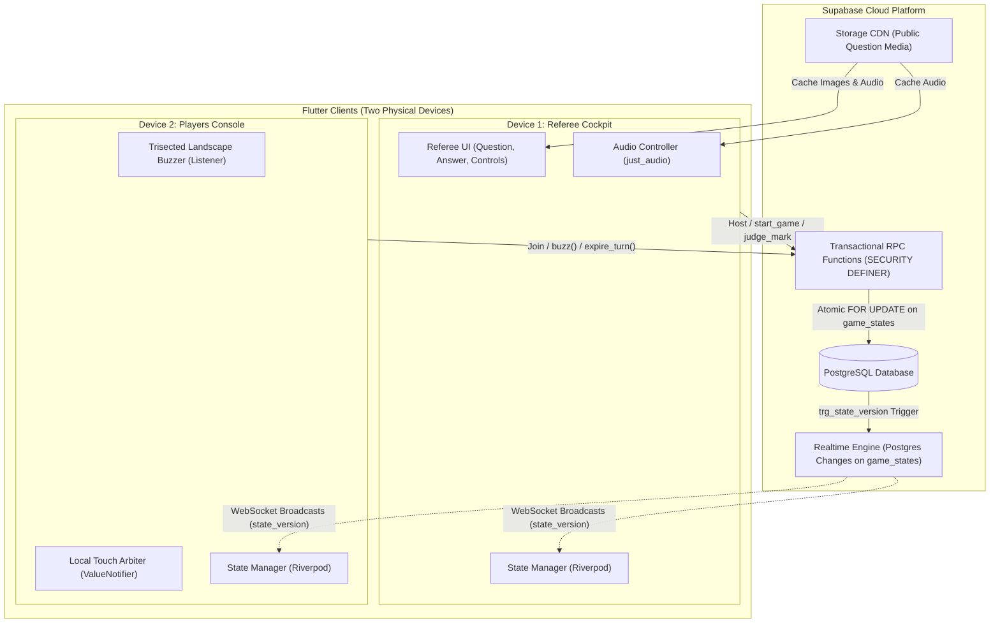

# Quiz Buzzer — 2-Device Architecture

*   **Author:** YakootShaker
*   **Status:** Approved (Production-Ready)
*   **Date:** 2026-11-15

--------------------------------------------------------------------------------

## Overview

Quiz Buzzer is a real-time multiplayer trivia buzzer application built with Flutter and Supabase. The system operates on a dedicated two-device topology per room:
1. **Device 1 (Referee Cockpit):** Hosts game flow control, question presentation (text, image, audio), reference answers, audio playback triggers, and manual score adjudication (+1 / −1).
2. **Device 2 (Players Console):** A single landscape-oriented smartphone or tablet shared by three players, split into three equal vertical columns acting as large tap targets. No question content or answers are displayed on this screen.

Authoritative room state, score tracking, question catalogs, and turn deadlines reside in Supabase (Postgres, Realtime, and Storage). The Referee manually judges all spoken verbal answers, maintaining human pacing and social interaction.

--------------------------------------------------------------------------------

## The Problem

Standard party trivia games and digital buzzer apps suffer from four primary failure modes:
1. **Network Latency Bias in BYOD Setup:** When each player uses their own phone over cellular or variable Wi-Fi connections, physical buzzer races are distorted by 50–200ms network round-trip discrepancies, giving unfair advantages to players with faster connections.
2. **High Setup Friction:** Requiring every player at a social gathering to install an app, configure accounts, or pair over unstable local Wi-Fi hotspots causes setup delays and user drop-off.
3. **Screen Clutter & Visual Misalignment:** Attempting to display questions, images, answer options, and buzzer buttons simultaneously on small individual screens distracts players and causes accidental touches.
4. **Timer Desynchronization & Runaway Game Loops:** Automated client timers that deduct points autonomously conflict with human verbal answers, and systems that automatically advance questions without human intermissions destroy living-room game pacing.

Quiz Buzzer resolves these challenges by consolidating all three players onto a single shared landscape device with sub-frame local hardware touch arbitration (eliminating network variance between players), restricting all question content to the Referee device, and anchoring all turn deadlines to authoritative server timestamps with Referee-controlled pacing.

--------------------------------------------------------------------------------

## Goals

*   **Fixed 2-Device Room Topology:** Exactly one Referee device and one shared Players Console per game room, paired via a 6-digit numeric PIN.
*   **Sub-Frame Local Hardware Touch Arbitration:** First-touch detection executed locally on the Players Console using raw pointer event listeners (`Listener(onPointerDown: ...)`), immediately locking out adjacent columns synchronously (< 16ms) before dispatching the server RPC.
*   **Referee-Controlled Pacing (Two-Phase Turn Cycle):** Question presentation (`question_revealed`) is decoupled from buzzer activation (`buzzer_active`). The Referee reveals the clue, buffers media, and opens the buzzers when ready.
*   **Server-Authoritative Turn Deadline:** 10-second countdown deadlines anchored to Postgres `clock_timestamp()`. Turn expiration is invariant to client app suspension or network drops.
*   **Human-Centered Verbal Adjudication:** The Referee remains the sole arbiter of answer validity and timeouts. Timer completion prompts the Referee rather than autonomously docking points.
*   **Steal Mechanic with Progressive Player Lock:** When a player answers incorrectly (−1), the buzzer reopens immediately for the remaining unlocked players. If a second player misses, only the third player may attempt.
*   **Strict Content Isolation:** All question text, image assets, audio controls, reference answers, and judge notes appear exclusively on the Referee screen. The Players Console displays only reactive buzzer columns.
*   **Role-Locked Anonymous Reconnection:** Bound by Supabase anonymous `auth.uid()` mapped directly to `rooms.referee_uid` and `rooms.console_uid`. Only the two paired devices can reconnect to an in-progress session.
*   **Modal Disconnection Recovery:** When a device returns from background or restores connectivity, a modal "Reconnecting..." overlay halts user interaction while state is fetched, safely synchronizing timers.
*   **Unified Realtime State Engine:** All mutable gameplay state and player scores reside in a single table (`game_states`), eliminating multi-table lock deadlocks and guaranteeing synchronized Realtime score updates.

--------------------------------------------------------------------------------

## Non-Goals

*   **No Bring-Your-Own-Device (BYOD) for Individual Players:** Expanding beyond the 2-device topology is excluded in v1.
*   **No User Accounts or Persistent Authentication:** No email, phone, or social login. Access is strictly anonymous.
*   **No Offline or Local Mesh Mode:** Supabase cloud backend is required. Peer-to-peer / hotspot architecture from v1.0 is deprecated.
*   **No In-App Question Authoring:** Question authoring and asset management are conducted via external database scripts or administration tools.
*   **No Automated Speech or Audio Recognition:** All spoken responses are evaluated manually by the Referee.
*   **No Copyrighted Media:** Only public-domain and royalty-free images and audio clips are utilized for v1.
*   **No Background Daemon / Cron Jobs:** Turn expiration and state progression rely on transactional client RPCs with server time validation.

--------------------------------------------------------------------------------

## Open Questions

*   *None.* All architectural tradeoffs (2-device room topology, client-driven turn resolution, local touch arbitration, and Referee-controlled pacing) are finalized.

--------------------------------------------------------------------------------

## Critical User Journeys (CUJs)

### CUJ 1: Room Creation, PIN Pairing & Role Lock

*   **Given**: Referee device and Players Console device have the application installed and have internet access.
*   **When**:
    1. Referee selects "Host Game", receives a 6-digit PIN, enters names for Player 1, Player 2, and Player 3, and selects trivia categories.
    2. Players Console opens the app, selects "Join Game", enters the 6-digit PIN on `PinEntryScreen`, and taps "Join".
*   **Then**:
    1. Server binds `referee_uid` and `console_uid` to the room row via anonymous authentication tokens.
    2. `game_states` initializes in `lobby`.
    3. The Referee Cockpit dynamically updates to show "Console Connected" and enables the "Start Match" action.
    4. Any third device attempting to join with the same PIN is rejected with error code `ROOM_ALREADY_CLAIMED`.

### CUJ 2: Question Reveal & Buzzer Arming

*   **Given**: Room is in `lobby` with both devices connected.
*   **When**:
    1. Referee taps "Start Match" (calling `start_game`).
    2. Server transitions to `question_revealed`, drawing an unused question from `selected_categories`.
*   **Then**:
    1. Referee Cockpit receives full question content, reference answers, and audio player controls.
    2. Players Console receives the state update and displays three colored buzzer columns in a disarmed "Listening" state (ignoring taps).
    3. Referee reads the question (or triggers audio) and taps "Open Buzzer" (calling `arm_buzzer`).
    4. Server sets `phase = 'buzzer_active'`. Players Console buzzers become live and interactive.

### CUJ 3: Sub-Frame Buzz, Turn Countdown & Correct Answer

*   **Given**: Room is in `buzzer_active`.
*   **When**:
    1. Player 1 touches Column 1 on the Players Console.
*   **Then**:
    1. Players Console triggers immediate subtle haptic confirmation, locks Columns 2 and 3 synchronously in the UI thread (< 16ms), and dispatches `buzz(room_id, 0)`.
    2. Server validates `phase = 'buzzer_active'`, sets `phase = 'player_answering'`, `active_player_index = 0`, and `buzz_expires_at = clock_timestamp() + 10s`.
    3. Both devices receive the state update: Player 1's column flashes with signature color, and a 10-second countdown runs.
    4. Player 1 speaks the answer. Referee taps "Correct (+1)" (calling `judge_mark(room_id, 'correct')`).
    5. Server increments Player 1's score to 1, logs the event in `score_log`, sets `phase = 'question_revealed'`, and selects the next question.

### CUJ 4: Wrong Answer, Score Deduction & Steal Reopen

*   **Given**: Player 1 has buzzed in (`player_answering`) and gives an incorrect answer.
*   **When**: Referee taps "Incorrect (−1)" (calling `judge_mark(room_id, 'incorrect')`).
*   **Then**:
    1. Server deducts 1 point from Player 1, records the event in `score_log`, and appends `0` to `locked_player_indices`.
    2. Server sets `phase = 'buzzer_active'`, `active_player_index = NULL`, and `buzz_expires_at = NULL`.
    3. Players Console receives update: Column 1 remains visually dimmed and disabled; Columns 2 and 3 reopen for buzzes.
    4. Local touch lockout resets. Player 2 touches Column 2: a fresh 10-second countdown begins for Player 2.
    5. If all three players answer incorrectly or time out, the server automatically transitions to `question_revealed` with the next question.

### CUJ 5: Timer Expiration & Human Confirmation

*   **Given**: Player 2 has buzzed in. 10 seconds elapse while Player 2 hesitates.
*   **When**: The 10-second timer hits zero on both devices.
*   **Then**:
    1. Both devices play a timeout chime. Players Console disables Column 2.
    2. Client calls `expire_turn(room_id)`.
    3. Server updates `phase = 'judge_evaluating'`, freezing the countdown without docking points.
    4. The Referee Cockpit highlights evaluation choices: "Timeout (-1)" or "Spoke in Time (+1)".
    5. Referee confirms "Timeout (-1)". Server deducts 1 point, adds Player 2 to `locked_player_indices`, and reopens buzzers for Player 3.

### CUJ 6: Match Conclusion & Victory State

*   **Given**: Player 3 has 9 points. Room is in `player_answering` with Player 3 answering.
*   **When**: Referee taps "Correct (+1)".
*   **Then**:
    1. Server increments Player 3's score to 10.
    2. Server detects `player_scores[3] >= 10`, sets `phase = 'game_over'`, and sets `winner_player_index = 2`.
    3. Both screens display `GameOverDialog` showing final scores, winner podium, and shareable summary card.

--------------------------------------------------------------------------------

## Technical Plan (Architecture)

### 1. High-Level System Architecture



### 2. Authoritative State Machine & Lifecycle

The room state advances through five persisted database phases:

```
[lobby] ───────────► [question_revealed] ───────────► [buzzer_active]
                          ▲                                │
                          │ (Next Question)                │ (First Touch Registered)
                          │ (All 3 Players Locked)         ▼
                          ├───────────────────────── [player_answering]
                          │                                │
                          │ (Wrong Answer / Steal Reopen)  │ (Timer Elapses)
                          │ ◄──────────────────────────────▼
                          │                        [judge_evaluating]
                          │                                │
                          ▼ (Player Score >= 10)           │ (Referee Confirms Verdict)
                      [game_over] ◄────────────────────────┘
```

#### State Transition Matrix

| Source Phase | Trigger / Action | Guard / Condition | Target Phase | Side Effects |
|---|---|---|---|---|
| `lobby` | `start_game` | `auth.uid() = referee_uid` AND `console_uid IS NOT NULL` | `question_revealed` | Draws first question; sets `current_question_id`. |
| `question_revealed` | `arm_buzzer` | `auth.uid() = referee_uid` | `buzzer_active` | Unlocks non-penalized buzzer columns on console. |
| `buzzer_active` | `buzz(player)` | `auth.uid() = console_uid` AND `player NOT IN locked_player_indices` | `player_answering` | Locks columns; sets `active_player_index` & `buzz_expires_at = clock_timestamp() + 10s`. Ducks audio. |
| `player_answering` | `judge_mark('correct')` | `auth.uid() = referee_uid` | `question_revealed` (or `game_over`) | Awards +1 point. If score >= 10, sets `game_over`. Else draws next question. |
| `player_answering` | `judge_mark('incorrect')` | `auth.uid() = referee_uid` | `buzzer_active` (or `question_revealed`) | Deducts -1 point; appends player to `locked_player_indices`. If < 3 locked, reopens buzzers. Else next question. |
| `player_answering` | `expire_turn` | `clock_timestamp() >= buzz_expires_at` | `judge_evaluating` | Freezes countdown; prompts Referee for timeout confirmation. |
| `judge_evaluating` | `judge_mark('incorrect')` | `auth.uid() = referee_uid` | `buzzer_active` (or `question_revealed`) | Deducts -1 timeout penalty; appends player to `locked_player_indices`. Reopens steal or advances. |
| `judge_evaluating` | `judge_mark('correct')` | `auth.uid() = referee_uid` | `question_revealed` (or `game_over`) | Awards +1 point (referee confirms player spoke in time). Next question or game over. |
| Any active | `skip_question` | `auth.uid() = referee_uid` | `question_revealed` (or `game_over`) | Cancels turn without penalty; draws next question. |

--------------------------------------------------------------------------------

### 3. Data Model & Database Schema

All mutable session state is consolidated into `game_states` to eliminate multi-table lock deadlocks and guarantee unified Realtime broadcasts:

```sql
-- Extensions
CREATE EXTENSION IF NOT EXISTS "pgcrypto";

-- 1. Rooms Table (Static Room Metadata & Lifecycle)
CREATE TABLE rooms (
  id                  UUID PRIMARY KEY DEFAULT gen_random_uuid(),
  room_pin            VARCHAR(6) NOT NULL,
  referee_uid         UUID NOT NULL REFERENCES auth.users(id),
  console_uid         UUID REFERENCES auth.users(id),
  selected_categories TEXT[] NOT NULL DEFAULT ARRAY[]::TEXT[],
  created_at          TIMESTAMPTZ NOT NULL DEFAULT clock_timestamp(),
  room_expires_at     TIMESTAMPTZ NOT NULL DEFAULT (clock_timestamp() + INTERVAL '4 hours')
);

-- Partial Unique Index (Prevents Collisions While Allowing Expired Room Re-Use)
CREATE UNIQUE INDEX idx_rooms_active_pin 
  ON rooms(room_pin) 
  WHERE room_expires_at > clock_timestamp();

-- 2. Questions Bank (Global Catalog)
CREATE TABLE questions (
  id               UUID PRIMARY KEY DEFAULT gen_random_uuid(),
  category         TEXT NOT NULL,
  question_type    TEXT NOT NULL CHECK (question_type IN ('text', 'image', 'audio')),
  question_text    TEXT,
  image_url        TEXT,
  audio_url        TEXT,
  reference_answer TEXT NOT NULL,
  judge_notes      TEXT,
  difficulty       INT NOT NULL DEFAULT 1,
  created_at       TIMESTAMPTZ NOT NULL DEFAULT clock_timestamp()
);

-- 3. Room-Question Join Table (Prevents Question Repetition)
CREATE TABLE room_questions (
  room_id     UUID NOT NULL REFERENCES rooms(id) ON DELETE CASCADE,
  question_id UUID NOT NULL REFERENCES questions(id) ON DELETE CASCADE,
  asked_at    TIMESTAMPTZ NOT NULL DEFAULT clock_timestamp(),
  PRIMARY KEY (room_id, question_id)
);

-- 4. Game States Table (Unified Mutable Session State)
CREATE TABLE game_states (
  room_id               UUID PRIMARY KEY REFERENCES rooms(id) ON DELETE CASCADE,
  phase                 TEXT NOT NULL DEFAULT 'lobby' 
                        CHECK (phase IN ('lobby', 'question_revealed', 'buzzer_active', 'player_answering', 'judge_evaluating', 'game_over')),
  state_version         BIGINT NOT NULL DEFAULT 0,
  player_names          TEXT[] NOT NULL DEFAULT ARRAY['Player 1', 'Player 2', 'Player 3'],
  player_scores         INT[] NOT NULL DEFAULT ARRAY[0, 0, 0],
  current_question_id   UUID REFERENCES questions(id),
  active_player_index   INT CHECK (active_player_index IN (0, 1, 2)),
  locked_player_indices INT[] NOT NULL DEFAULT ARRAY[]::INT[],
  buzz_expires_at       TIMESTAMPTZ,
  winner_player_index   INT CHECK (winner_player_index IN (0, 1, 2)),
  updated_at            TIMESTAMPTZ NOT NULL DEFAULT clock_timestamp()
);

-- Enable Replica Identity for Full Row Delivery under RLS
ALTER TABLE game_states REPLICA IDENTITY FULL;

-- Add Table to Supabase Realtime Publication
ALTER PUBLICATION supabase_realtime ADD TABLE game_states;

-- 5. Score Event Audit Log
CREATE TABLE score_log (
  id           BIGSERIAL PRIMARY KEY,
  room_id      UUID NOT NULL REFERENCES rooms(id) ON DELETE CASCADE,
  question_id  UUID REFERENCES questions(id),
  player_index INT NOT NULL CHECK (player_index IN (0, 1, 2)),
  delta        INT NOT NULL,
  reason       TEXT NOT NULL CHECK (reason IN ('correct', 'incorrect', 'timeout', 'manual_adjust', 'skip')),
  created_at   TIMESTAMPTZ NOT NULL DEFAULT clock_timestamp()
);

-- Indexes for Fast Lookups
CREATE INDEX idx_questions_category ON questions(category);
CREATE INDEX idx_room_questions_room ON room_questions(room_id);
CREATE INDEX idx_score_log_room ON score_log(room_id);

-- Auto-Increment Trigger for state_version and updated_at
CREATE OR REPLACE FUNCTION increment_state_version()
RETURNS TRIGGER LANGUAGE plpgsql AS $$
BEGIN
  NEW.state_version := OLD.state_version + 1;
  NEW.updated_at    := clock_timestamp();
  RETURN NEW;
END;
$$;

CREATE TRIGGER trg_state_version
  BEFORE UPDATE ON game_states
  FOR EACH ROW EXECUTE FUNCTION increment_state_version();
```

--------------------------------------------------------------------------------

### 4. Authoritative Server RPCs

All transactional operations execute with `SECURITY DEFINER`, search path hardening, caller identity assertions (`auth.uid()`), and strict single-table `FOR UPDATE` locking on `game_states`:

#### 4.1 Room Creation (`create_room`)
```sql
CREATE OR REPLACE FUNCTION create_room(
  p_categories TEXT[],
  p_player_names TEXT[]
)
RETURNS JSONB LANGUAGE plpgsql SECURITY DEFINER SET search_path = public, pg_temp AS $$
DECLARE
  v_room_id UUID;
  v_pin VARCHAR(6);
BEGIN
  -- Purge expired rooms to free PIN keyspace
  DELETE FROM rooms WHERE room_expires_at <= clock_timestamp();

  -- Generate unique 6-digit numeric PIN
  LOOP
    v_pin := lpad(floor(random() * 1000000)::TEXT, 6, '0');
    EXIT WHEN NOT EXISTS (
      SELECT 1 FROM rooms WHERE room_pin = v_pin AND room_expires_at > clock_timestamp()
    );
  END LOOP;

  INSERT INTO rooms (room_pin, referee_uid, selected_categories)
  VALUES (v_pin, auth.uid(), p_categories)
  RETURNING id INTO v_room_id;

  INSERT INTO game_states (room_id, phase, player_names)
  VALUES (v_room_id, 'lobby', p_player_names);

  RETURN jsonb_build_object(
    'success', true,
    'room_id', v_room_id,
    'room_pin', v_pin
  );
END;
$$;
```

#### 4.2 Room Join (`join_room`)
```sql
CREATE OR REPLACE FUNCTION join_room(p_pin VARCHAR(6))
RETURNS JSONB LANGUAGE plpgsql SECURITY DEFINER SET search_path = public, pg_temp AS $$
DECLARE
  v_room rooms;
  v_state game_states;
BEGIN
  SELECT * INTO v_room FROM rooms 
  WHERE room_pin = p_pin AND room_expires_at > clock_timestamp()
  FOR UPDATE;

  IF NOT FOUND THEN
    RETURN jsonb_build_object('success', false, 'error', 'ROOM_NOT_FOUND');
  END IF;

  -- Reconnection check for existing paired console
  IF v_room.console_uid IS NOT NULL AND v_room.console_uid = auth.uid() THEN
    SELECT * INTO v_state FROM game_states WHERE room_id = v_room.id;
    RETURN jsonb_build_object(
      'success', true,
      'room_id', v_room.id,
      'player_names', v_state.player_names,
      'reconnected', true
    );
  END IF;

  -- Initial Console Pairing
  IF v_room.console_uid IS NOT NULL THEN
    RETURN jsonb_build_object('success', false, 'error', 'ROOM_ALREADY_CLAIMED');
  END IF;

  UPDATE rooms SET console_uid = auth.uid() WHERE id = v_room.id;

  -- Touch game_states to notify Referee Cockpit that console paired
  UPDATE game_states SET updated_at = clock_timestamp() WHERE room_id = v_room.id
  RETURNING * INTO v_state;

  RETURN jsonb_build_object(
    'success', true,
    'room_id', v_room.id,
    'player_names', v_state.player_names,
    'reconnected', false
  );
END;
$$;
```

#### 4.3 Match Start (`start_game`)
```sql
CREATE OR REPLACE FUNCTION start_game(p_room_id UUID, p_category TEXT DEFAULT NULL)
RETURNS JSONB LANGUAGE plpgsql SECURITY DEFINER SET search_path = public, pg_temp AS $$
DECLARE
  v_room rooms;
  v_state game_states;
  v_question questions;
  v_chosen_cat TEXT;
BEGIN
  SELECT * INTO v_room FROM rooms WHERE id = p_room_id;
  IF v_room.referee_uid <> auth.uid() THEN
    RAISE EXCEPTION 'UNAUTHORIZED_REFEREE';
  END IF;

  SELECT * INTO v_state FROM game_states WHERE room_id = p_room_id FOR UPDATE;
  IF v_state.phase <> 'lobby' THEN
    RETURN jsonb_build_object('success', false, 'error', 'NOT_IN_LOBBY');
  END IF;

  v_chosen_cat := COALESCE(p_category, v_room.selected_categories[1]);

  -- Select initial question
  SELECT * INTO v_question FROM questions q
  WHERE q.category = v_chosen_cat
    AND q.id NOT IN (SELECT question_id FROM room_questions WHERE room_id = p_room_id)
  ORDER BY random() LIMIT 1;

  IF NOT FOUND THEN
    RETURN jsonb_build_object('success', false, 'error', 'NO_QUESTIONS_AVAILABLE');
  END IF;

  INSERT INTO room_questions (room_id, question_id) VALUES (p_room_id, v_question.id);

  UPDATE game_states SET
    phase = 'question_revealed',
    current_question_id = v_question.id,
    active_player_index = NULL,
    locked_player_indices = ARRAY[]::INT[],
    buzz_expires_at = NULL
  WHERE room_id = p_room_id;

  RETURN jsonb_build_object(
    'success', true,
    'question', jsonb_build_object(
      'id', v_question.id,
      'category', v_question.category,
      'question_type', v_question.question_type,
      'question_text', v_question.question_text,
      'image_url', v_question.image_url,
      'audio_url', v_question.audio_url,
      'reference_answer', v_question.reference_answer,
      'judge_notes', v_question.judge_notes
    )
  );
END;
$$;
```

#### 4.4 Buzzer Arming (`arm_buzzer`)
```sql
CREATE OR REPLACE FUNCTION arm_buzzer(p_room_id UUID)
RETURNS JSONB LANGUAGE plpgsql SECURITY DEFINER SET search_path = public, pg_temp AS $$
DECLARE
  v_room rooms;
  v_state game_states;
BEGIN
  SELECT * INTO v_room FROM rooms WHERE id = p_room_id;
  IF v_room.referee_uid <> auth.uid() THEN
    RAISE EXCEPTION 'UNAUTHORIZED_REFEREE';
  END IF;

  SELECT * INTO v_state FROM game_states WHERE room_id = p_room_id FOR UPDATE;
  IF v_state.phase <> 'question_revealed' THEN
    RETURN jsonb_build_object('success', false, 'error', 'NOT_IN_QUESTION_REVEALED');
  END IF;

  UPDATE game_states SET
    phase = 'buzzer_active',
    active_player_index = NULL,
    buzz_expires_at = NULL
  WHERE room_id = p_room_id;

  RETURN jsonb_build_object('success', true);
END;
$$;
```

#### 4.5 Atomic Buzzer Press (`buzz`)
```sql
CREATE OR REPLACE FUNCTION buzz(p_room_id UUID, p_player_index INT)
RETURNS JSONB LANGUAGE plpgsql SECURITY DEFINER SET search_path = public, pg_temp AS $$
DECLARE
  v_room rooms;
  v_state game_states;
  v_expires TIMESTAMPTZ;
BEGIN
  SELECT * INTO v_room FROM rooms WHERE id = p_room_id;
  IF v_room.console_uid <> auth.uid() THEN
    RAISE EXCEPTION 'UNAUTHORIZED_CONSOLE';
  END IF;

  IF p_player_index NOT IN (0, 1, 2) THEN
    RETURN jsonb_build_object('accepted', false, 'reason', 'INVALID_PLAYER');
  END IF;

  SELECT * INTO v_state FROM game_states WHERE room_id = p_room_id FOR UPDATE;

  IF v_state.phase <> 'buzzer_active' THEN
    RETURN jsonb_build_object('accepted', false, 'reason', 'WRONG_PHASE');
  END IF;

  IF p_player_index = ANY(v_state.locked_player_indices) THEN
    RETURN jsonb_build_object('accepted', false, 'reason', 'PLAYER_LOCKED');
  END IF;

  v_expires := clock_timestamp() + INTERVAL '10 seconds';

  UPDATE game_states SET
    phase               = 'player_answering',
    active_player_index = p_player_index,
    buzz_expires_at     = v_expires
  WHERE room_id = p_room_id;

  RETURN jsonb_build_object(
    'accepted', true,
    'active_player', p_player_index,
    'expires_at', v_expires
  );
END;
$$;
```

#### 4.6 Judgment Evaluation (`judge_mark`)
```sql
CREATE OR REPLACE FUNCTION judge_mark(
  p_room_id UUID, 
  p_verdict TEXT, -- 'correct' or 'incorrect'
  p_category TEXT DEFAULT NULL
)
RETURNS JSONB LANGUAGE plpgsql SECURITY DEFINER SET search_path = public, pg_temp AS $$
DECLARE
  v_room rooms;
  v_state game_states;
  v_player INT;
  v_scores INT[];
  v_locked INT[];
  v_new_q questions;
  v_winner INT;
BEGIN
  SELECT * INTO v_room FROM rooms WHERE id = p_room_id;
  IF v_room.referee_uid <> auth.uid() THEN
    RAISE EXCEPTION 'UNAUTHORIZED_REFEREE';
  END IF;

  SELECT * INTO v_state FROM game_states WHERE room_id = p_room_id FOR UPDATE;

  IF v_state.phase NOT IN ('player_answering', 'judge_evaluating') THEN
    RETURN jsonb_build_object('success', false, 'error', 'INVALID_PHASE_FOR_JUDGING');
  END IF;

  v_player := v_state.active_player_index;
  v_scores := v_state.player_scores;

  IF p_verdict = 'correct' THEN
    v_scores[v_player + 1] := v_scores[v_player + 1] + 1;

    INSERT INTO score_log (room_id, question_id, player_index, delta, reason)
    VALUES (p_room_id, v_state.current_question_id, v_player, 1, 'correct');

    -- Win Condition: First player to 10 points
    IF v_scores[v_player + 1] >= 10 THEN
      UPDATE game_states SET
        phase = 'game_over',
        player_scores = v_scores,
        winner_player_index = v_player,
        active_player_index = NULL,
        buzz_expires_at = NULL
      WHERE room_id = p_room_id;

      RETURN jsonb_build_object('success', true, 'outcome', 'GAME_OVER', 'winner', v_player);
    END IF;

    -- Pick Next Question for question_revealed
    SELECT * INTO v_new_q FROM questions q
    WHERE q.category = COALESCE(p_category, v_room.selected_categories[1])
      AND q.id NOT IN (SELECT question_id FROM room_questions WHERE room_id = p_room_id)
    ORDER BY random() LIMIT 1;

    IF NOT FOUND THEN
      -- Handle question exhaustion by finding top scorer
      SELECT array_position(v_scores, max(s)) - 1 INTO v_winner FROM unnest(v_scores) s;
      UPDATE game_states SET phase = 'game_over', player_scores = v_scores, winner_player_index = v_winner WHERE room_id = p_room_id;
      RETURN jsonb_build_object('success', true, 'outcome', 'QUESTIONS_EXHAUSTED', 'winner', v_winner);
    END IF;

    INSERT INTO room_questions (room_id, question_id) VALUES (p_room_id, v_new_q.id);

    UPDATE game_states SET
      phase = 'question_revealed',
      player_scores = v_scores,
      current_question_id = v_new_q.id,
      active_player_index = NULL,
      locked_player_indices = ARRAY[]::INT[],
      buzz_expires_at = NULL
    WHERE room_id = p_room_id;

    RETURN jsonb_build_object('success', true, 'outcome', 'NEXT_QUESTION');

  ELSIF p_verdict = 'incorrect' THEN
    v_scores[v_player + 1] := v_scores[v_player + 1] - 1;

    INSERT INTO score_log (room_id, question_id, player_index, delta, reason)
    VALUES (p_room_id, v_state.current_question_id, v_player, -1, 'incorrect');

    v_locked := array_append(v_state.locked_player_indices, v_player);

    -- If all 3 players missed, advance to next question
    IF cardinality(v_locked) >= 3 THEN
      SELECT * INTO v_new_q FROM questions q
      WHERE q.category = COALESCE(p_category, v_room.selected_categories[1])
        AND q.id NOT IN (SELECT question_id FROM room_questions WHERE room_id = p_room_id)
      ORDER BY random() LIMIT 1;

      IF NOT FOUND THEN
        SELECT array_position(v_scores, max(s)) - 1 INTO v_winner FROM unnest(v_scores) s;
        UPDATE game_states SET phase = 'game_over', player_scores = v_scores, winner_player_index = v_winner WHERE room_id = p_room_id;
        RETURN jsonb_build_object('success', true, 'outcome', 'QUESTIONS_EXHAUSTED', 'winner', v_winner);
      END IF;

      INSERT INTO room_questions (room_id, question_id) VALUES (p_room_id, v_new_q.id);

      UPDATE game_states SET
        phase = 'question_revealed',
        player_scores = v_scores,
        current_question_id = v_new_q.id,
        active_player_index = NULL,
        locked_player_indices = ARRAY[]::INT[],
        buzz_expires_at = NULL
      WHERE room_id = p_room_id;

      RETURN jsonb_build_object('success', true, 'outcome', 'ALL_LOCKED_NEXT_QUESTION');
    ELSE
      -- Reopen buzzer for remaining players to steal
      UPDATE game_states SET
        phase = 'buzzer_active',
        player_scores = v_scores,
        active_player_index = NULL,
        locked_player_indices = v_locked,
        buzz_expires_at = NULL
      WHERE room_id = p_room_id;

      RETURN jsonb_build_object('success', true, 'outcome', 'STEAL_REOPENED', 'locked', v_locked);
    END IF;
  END IF;

  RETURN jsonb_build_object('success', false, 'error', 'INVALID_VERDICT');
END;
$$;
```

#### 4.7 Turn Expiration Trigger (`expire_turn`)
```sql
CREATE OR REPLACE FUNCTION expire_turn(p_room_id UUID)
RETURNS JSONB LANGUAGE plpgsql SECURITY DEFINER SET search_path = public, pg_temp AS $$
DECLARE
  v_state game_states;
BEGIN
  SELECT * INTO v_state FROM game_states WHERE room_id = p_room_id FOR UPDATE;

  -- 250ms tolerance cushion prevents premature client clock rejections
  IF v_state.phase <> 'player_answering' 
     OR (v_state.buzz_expires_at - INTERVAL '250 milliseconds') > clock_timestamp() THEN
    RETURN jsonb_build_object('transitioned', false, 'reason', 'NOT_EXPIRED');
  END IF;

  -- Transition to judge_evaluating without docking points automatically
  UPDATE game_states SET
    phase = 'judge_evaluating',
    buzz_expires_at = NULL
  WHERE room_id = p_room_id;

  RETURN jsonb_build_object('transitioned', true);
END;
$$;
```

#### 4.8 Manual Score Adjustment (`adjust_score`)
```sql
CREATE OR REPLACE FUNCTION adjust_score(
  p_room_id UUID, 
  p_player_index INT, 
  p_delta INT
)
RETURNS JSONB LANGUAGE plpgsql SECURITY DEFINER SET search_path = public, pg_temp AS $$
DECLARE
  v_room rooms;
  v_state game_states;
  v_scores INT[];
BEGIN
  SELECT * INTO v_room FROM rooms WHERE id = p_room_id;
  IF v_room.referee_uid <> auth.uid() THEN
    RAISE EXCEPTION 'UNAUTHORIZED_REFEREE';
  END IF;

  IF p_player_index NOT IN (0, 1, 2) THEN
    RETURN jsonb_build_object('success', false, 'error', 'INVALID_PLAYER_INDEX');
  END IF;

  SELECT * INTO v_state FROM game_states WHERE room_id = p_room_id FOR UPDATE;
  v_scores := v_state.player_scores;
  v_scores[p_player_index + 1] := v_scores[p_player_index + 1] + p_delta;

  INSERT INTO score_log (room_id, player_index, delta, reason)
  VALUES (p_room_id, p_player_index, p_delta, 'manual_adjust');

  IF v_scores[p_player_index + 1] >= 10 THEN
    UPDATE game_states SET
      phase = 'game_over',
      player_scores = v_scores,
      winner_player_index = p_player_index,
      active_player_index = NULL,
      buzz_expires_at = NULL
    WHERE room_id = p_room_id;
  ELSE
    UPDATE game_states SET player_scores = v_scores WHERE room_id = p_room_id;
  END IF;

  RETURN jsonb_build_object('success', true, 'player_scores', v_scores);
END;
$$;
```

#### 4.9 Skip Question (`skip_question`)
```sql
CREATE OR REPLACE FUNCTION skip_question(p_room_id UUID, p_category TEXT DEFAULT NULL)
RETURNS JSONB LANGUAGE plpgsql SECURITY DEFINER SET search_path = public, pg_temp AS $$
DECLARE
  v_room rooms;
  v_state game_states;
  v_new_q questions;
  v_winner INT;
BEGIN
  SELECT * INTO v_room FROM rooms WHERE id = p_room_id;
  IF v_room.referee_uid <> auth.uid() THEN
    RAISE EXCEPTION 'UNAUTHORIZED_REFEREE';
  END IF;

  SELECT * INTO v_state FROM game_states WHERE room_id = p_room_id FOR UPDATE;

  SELECT * INTO v_new_q FROM questions q
  WHERE q.category = COALESCE(p_category, v_room.selected_categories[1])
    AND q.id NOT IN (SELECT question_id FROM room_questions WHERE room_id = p_room_id)
  ORDER BY random() LIMIT 1;

  IF NOT FOUND THEN
    SELECT array_position(v_state.player_scores, max(s)) - 1 INTO v_winner FROM unnest(v_state.player_scores) s;
    UPDATE game_states SET phase = 'game_over', winner_player_index = v_winner WHERE room_id = p_room_id;
    RETURN jsonb_build_object('success', true, 'outcome', 'QUESTIONS_EXHAUSTED', 'winner', v_winner);
  END IF;

  INSERT INTO room_questions (room_id, question_id) VALUES (p_room_id, v_new_q.id);

  UPDATE game_states SET
    phase = 'question_revealed',
    current_question_id = v_new_q.id,
    active_player_index = NULL,
    locked_player_indices = ARRAY[]::INT[],
    buzz_expires_at = NULL
  WHERE room_id = p_room_id;

  RETURN jsonb_build_object('success', true, 'outcome', 'QUESTION_SKIPPED');
END;
$$;
```

#### 4.10 Server Time Probe (`get_server_time`)
```sql
CREATE OR REPLACE FUNCTION get_server_time()
RETURNS TIMESTAMPTZ LANGUAGE sql STABLE AS $$
  SELECT clock_timestamp();
$$;
```

--------------------------------------------------------------------------------

### 5. Client Subsystems & Architectural Patterns

#### 5.1 Touch Arbitration Engine (Players Console)
*   **Hardware Interface**: Raw `Listener(onPointerDown: ...)` with `HitTestBehavior.opaque` across three expanded flex columns, separated by 12dp neutral dead-zone gutters.
*   **Synchronous UI Lockout**: On `PointerDownEvent`, the widget validates that `columnIndex` is NOT present in `lockedPlayerIndices`. Only then does it set `localActivePlayer.value = columnIndex` synchronously in the UI frame (< 16ms). Any touch on remaining columns while `localActivePlayer.value != null` is discarded before entering the asynchronous event loop.
*   **Two-Tier Feedback**:
    *   *Tier 1 (Synchronous, 0ms)*: Local subtle tactile tick (`HapticFeedback.selectionClick()`) and touch ripple.
    *   *Tier 2 (Authoritative, ~50–100ms)*: Full buzzer horn (`buzz.mp3`), heavy vibration, and active column pulse animation fire upon receiving server confirmation or `player_answering` broadcast.
*   **Reset Hook**: `localActivePlayer.value` is reset to `null` whenever `phase` transitions to `question_revealed`, `buzzer_active`, or whenever `active_player_index == null`.

#### 5.2 Server Probe Clock Synchronization
*   On room pairing or reconnection, the client probes `get_server_time()` and computes:
    $$\Delta_{\text{clock}} = T_{\text{server}} + \frac{RTT}{2} - T_{\text{local}}$$
*   The countdown provider calculates remaining time as:
    $$t_{\text{remaining}} = \max\left(0, T_{\text{buzz\_expires\_at}} - \left(T_{\text{local}} + \Delta_{\text{clock}}\right)\right)$$
*   Combined with the server's 250ms expiration cushion, this prevents premature turn expiration rejections.

#### 5.3 Audio Streaming & Automatic Ducking
*   **Package**: `just_audio` using `AudioPlayer`.
*   **Pre-Caching**: In `question_revealed`, if `question_type == 'audio'`, the Referee client loads the audio stream while the card renders.
*   **Automatic Ducking**: In `QuestionDisplayCard`, a listener monitors `gameStateProvider`. The moment `phase` transitions to `player_answering`, `player.pause()` is invoked immediately, ensuring the player's spoken answer is clearly audible.

--------------------------------------------------------------------------------

## Alternatives Considered

### Alternative 1: Bring-Your-Own-Device (One Phone Per Player)
*   **Pros**: Familiar party game format; players hold their own phones.
*   **Cons**: 50–200ms network round-trip discrepancies distort physical buzzer fairness; setup friction quadruples.
*   **Rejection Rationale**: Consolidating players onto a single shared landscape console eliminates network latency variance through hardware pointer arbitration.

### Alternative 2: Local Wi-Fi Hotspot Mesh (v1.0 Architecture)
*   **Pros**: Operates without internet access; zero cloud costs.
*   **Cons**: Modern Android (API 29+) and iOS permission restrictions penalize local hotspot creation; high failure rate.
*   **Rejection Rationale**: Unstable local Wi-Fi hotspots cause frequent pairing failures. Supabase serverless infrastructure provides reliable persistence and zero network setup.

### Alternative 3: Server-Side Active Cron / Scheduled Background Workers
*   **Pros**: Guarantees background turn expiration when all clients drop.
*   **Cons**: Adds operational complexity and polling load for casual, low-frequency sessions.
*   **Rejection Rationale**: In a living-room session, client-driven RPCs with server timestamp guards (`FOR UPDATE`) completely resolve turn deadlines without background daemon infrastructure.

### Alternative 4: Full-Screen Hardware Touch with `GestureDetector`
*   **Pros**: Higher-level gesture recognition.
*   **Cons**: Flutter Gesture Arena introduces frame-level resolution delays to disambiguate taps from drags.
*   **Rejection Rationale**: Raw `Listener(onPointerDown: ...)` captures hardware contact immediately at the lowest engine layer, enabling synchronous lockouts.

--------------------------------------------------------------------------------

## Non-Functional Requirements

### Security & Privacy
*   **Anonymous Operation**: Zero PII is stored. Devices authenticate anonymously via Supabase Auth (`auth.uid()`).
*   **Row-Level Security (RLS)**: Enforces table isolation. Direct table mutations are disabled; all mutations flow through `SECURITY DEFINER` RPCs with `search_path = public, pg_temp` and caller identity validation.
*   **Question Isolation**: Clues and reference answers are accessible strictly to the Referee. The Players Console queries only `game_states`.

### Performance & Latency
*   **Local Touch Response**: Pointer contact to visual feedback must complete within a single UI frame (< 16ms).
*   **RPC Execution**: Stored procedures must execute in < 80ms on PostgreSQL.
*   **Media Footprint**: Images compressed to <= 300 KB; audio clips compressed to <= 10s CBR MP3 (<= 160 KB).

### Operational Resilience
*   **Screen Wake Lock**: `wakelock_plus` prevents OS screen dimming and sleeping during active matches.
*   **Automatic Room Expiration**: Unused rooms expire after 4 hours (`room_expires_at`).

--------------------------------------------------------------------------------

## Detailed Implementation Plan

### Target Files to Create/Modify

#### 1. Configuration & Project Initialization

*   **`pubspec.yaml`** (`Modify`):
    *   **Scope**: Project Dependency Manifest.
    *   **Proposed Changes**: Add production dependencies: `flutter_riverpod: ^2.5.1`, `supabase_flutter: ^2.5.6`, `go_router: ^14.1.4`, `just_audio: ^0.9.38`, `cached_network_image: ^3.3.1`, `share_plus: ^9.0.0`, `flutter_animate: ^4.5.0`, `google_fonts: ^6.2.1`, `wakelock_plus: ^1.2.5`, `shared_preferences: ^2.2.3`. Add dev dependencies: `mocktail: ^1.0.4`, `flutter_lints: ^4.0.0`. Configure asset paths for `assets/audio/buzz.mp3`.
    *   **Rationale**: Configures required libraries for state management, networking, audio streaming, screen sleep prevention, and test mocking.

*   **`analysis_options.yaml`** (`Modify`):
    *   **Scope**: Static Analysis Configuration.
    *   **Proposed Changes**: Enable strict inference, strict casts, and standard Flutter linter rules.
    *   **Rationale**: Prevents runtime type bugs in RPC response decoding.

*   **`android/app/src/main/AndroidManifest.xml`** (`Modify`):
    *   **Scope**: Android Platform Permissions.
    *   **Proposed Changes**: Add `android.permission.INTERNET`, `android.permission.VIBRATE`, and set `android:usesCleartextTraffic="true"` for local Supabase emulator testing.
    *   **Rationale**: Enables network access, haptics, and local network debugging.

*   **`ios/Runner/Info.plist`** (`Modify`):
    *   **Scope**: iOS Platform Configuration.
    *   **Proposed Changes**: Add `UIBackgroundModes` audio declaration if needed, and allow local networking clearances for testing.
    *   **Rationale**: Enables network connectivity and audio playback on iOS devices.

*   **`README.md`** (`Modify`):
    *   **Scope**: Project Documentation.
    *   **Proposed Changes**: Document 2-device topology, Supabase migration commands, and setup instructions.
    *   **Rationale**: Provides developer onboarding instructions.

#### 2. Backend Migrations & Database Scripts

*   **`supabase/migrations/20261115000000_create_quiz_buzzer_schema.sql`** (`Create`):
    *   **Scope**: PostgreSQL DDL Migration.
    *   **Proposed Changes**: Creates tables `rooms`, `game_states`, `questions`, `room_questions`, `score_log`. Configures `idx_rooms_active_pin` partial unique index, `trg_state_version` trigger, `REPLICA IDENTITY FULL`, and adds `game_states` to `supabase_realtime` publication.
    *   **Rationale**: Establishes the consolidated relational schema supporting atomic transitions and real-time broadcasts.

*   **`supabase/migrations/20261115000001_create_quiz_buzzer_rpcs.sql`** (`Create`):
    *   **Scope**: PL/pgSQL Stored Procedures.
    *   **Proposed Changes**: Implements `create_room`, `join_room`, `start_game`, `arm_buzzer`, `buzz`, `judge_mark`, `expire_turn`, `adjust_score`, `skip_question`, and `get_server_time` with `SECURITY DEFINER`, search path hardening, caller identity validation, and `FOR UPDATE` locks on `game_states`.
    *   **Rationale**: Implements all transactional game logic securely on the server.

*   **`supabase/migrations/20261115000002_create_quiz_buzzer_rls.sql`** (`Create`):
    *   **Scope**: Row-Level Security Policies.
    *   **Proposed Changes**: Enables RLS across all tables. Restricts direct table mutations; permits read access on `rooms` and `game_states` to paired anonymous UIDs. Restricts `questions` SELECT strictly to `referee_uid`.
    *   **Rationale**: Secures data while strictly maintaining Content Isolation for the console device.

*   **`supabase/seed.sql`** (`Create`):
    *   **Scope**: Seed Trivia Content.
    *   **Proposed Changes**: Inserts sample questions across 10 categories (text, royalty-free sample images, royalty-free audio clips).
    *   **Rationale**: Enables immediate local testing without manual database entry.

#### 3. Core Utilities & Infrastructure

*   **`lib/core/constants/app_colors.dart`** (`Create`):
    *   **Scope**: Visual Palette Definition.
    *   **Proposed Changes**: Defines player column colors: Player 1 / Index 0 (Electric Blue `#2979FF`), Player 2 / Index 1 (Coral Red `#FF5252`), Player 3 / Index 2 (Lime Green `#00E676`), and background neutrals.
    *   **Rationale**: Enforces distinct visual identities across both devices.

*   **`lib/core/constants/app_constants.dart`** (`Create`):
    *   **Scope**: Global Configuration Constants.
    *   **Proposed Changes**: Defines turn duration (`10s`), room TTL (`4h`), asset paths, and storage bucket names.
    *   **Rationale**: Eliminates magic numbers and centralizes parameter management.

*   **`lib/core/network/supabase_client.dart`** (`Create`):
    *   **Scope**: Network Client Provider.
    *   **Proposed Changes**: Exposes configured Supabase client and provides an anonymous sign-in helper that only executes if `supabase.auth.currentUser == null`.
    *   **Rationale**: Manages Supabase connectivity while preserving existing session UIDs across app restarts.

*   **`lib/core/audio/sound_service.dart`** (`Create`):
    *   **Scope**: Audio & SFX Controller.
    *   **Proposed Changes**: Manages audio playback: plays local asset buzzer sound (`buzz.mp3`), manages streaming `AudioPlayer` instance for trivia audio clips, and provides an immediate `pause()` hook for audio ducking on buzzes.
    *   **Rationale**: Decouples audio playback from UI widgets and eliminates audio overlap during answers.

*   **`lib/core/utils/clock_sync_service.dart`** (`Create`):
    *   **Scope**: Server Time Synchronization.
    *   **Proposed Changes**: Calls `get_server_time` RPC and calculates $\Delta_{\text{clock}} = T_{\text{server}} + \frac{RTT}{2} - T_{\text{local}}$.
    *   **Rationale**: Provides millisecond-level clock calibration for accurate countdown rendering.

#### 4. Routing & Application Scaffold

*   **`lib/main.dart`** (`Modify`):
    *   **Scope**: Application Bootstrap.
    *   **Proposed Changes**: Initializes Flutter widgets binding, Supabase client SDK, mounts `ProviderScope`, and runs `QuizBuzzerApp`.
    *   **Rationale**: Bootstrap entry point.

*   **`lib/app.dart`** (`Create`):
    *   **Scope**: Root Application Widget.
    *   **Proposed Changes**: Configures `MaterialApp.router` with dark theme styling and GoRouter configuration.
    *   **Rationale**: Houses application-wide presentation styling.

*   **`lib/routes/app_router.dart`** (`Create`):
    *   **Scope**: Declarative Route Table.
    *   **Proposed Changes**: Defines routes: `/` (LandingScreen), `/host` (RoomSetupScreen), `/join` (PinEntryScreen), `/referee/:roomId` (RefereeCockpitScreen), and `/console/:roomId` (PlayersConsoleScreen).
    *   **Rationale**: Manages navigation and parameter passing.

#### 5. Domain Entities & Data Repositories

*   **`lib/features/game/domain/room.dart`** (`Create`):
    *   **Scope**: Domain Entity.
    *   **Proposed Changes**: Model for room metadata: `id`, `roomPin`, `refereeUid`, `consoleUid`, and `selectedCategories`.
    *   **Rationale**: Represents room properties.

*   **`lib/features/game/domain/game_state.dart`** (`Create`):
    *   **Scope**: Domain Entity.
    *   **Proposed Changes**: Model for `game_states`: `roomId`, `phase`, `stateVersion`, `playerNames`, `playerScores`, `currentQuestionId`, `activePlayerIndex`, `lockedPlayerIndices`, `buzzExpiresAt`, and `winnerPlayerIndex`.
    *   **Rationale**: Core immutable state representation.

*   **`lib/features/game/domain/question.dart`** (`Create`):
    *   **Scope**: Domain Entity.
    *   **Proposed Changes**: Model for questions: `id`, `category`, `questionType`, `questionText`, `imageUrl`, `audioUrl`, `referenceAnswer`, and `judgeNotes`.
    *   **Rationale**: Encapsulates trivia questions.

*   **`lib/features/game/data/game_repository.dart`** (`Create`):
    *   **Scope**: Data Access Repository.
    *   **Proposed Changes**: Implements all client RPC invocations: `createRoom`, `joinRoom`, `startGame`, `armBuzzer`, `buzz`, `judgeMark`, `expireTurn`, `adjustScore`, `skipQuestion`, and `getServerTime`.
    *   **Rationale**: Isolates RPC network communications from presentation controllers.

*   **`lib/features/game/data/realtime_service.dart`** (`Create`):
    *   **Scope**: Realtime WebSocket Client.
    *   **Proposed Changes**: Subscribes to Postgres Changes on `game_states` for the active `roomId`. Applies incoming state snapshots monotonically when `state_version > local_version`.
    *   **Rationale**: Drives real-time UI synchronization without redundant HTTP polling.

#### 6. Presentation Layer & State Controllers

*   **`lib/features/game/presentation/providers/game_state_provider.dart`** (`Create`):
    *   **Scope**: Riverpod State Controller (`AsyncNotifier`).
    *   **Proposed Changes**: Manages active `GameState`, subscribes to `RealtimeService`, resets `localActivePlayer.value = null` on phase transitions, and exposes game action methods.
    *   **Rationale**: Primary reactive controller driving the application UI.

*   **`lib/features/game/presentation/providers/question_provider.dart`** (`Create`):
    *   **Scope**: Question Data Provider.
    *   **Proposed Changes**: Fetches and caches the full `Question` row for the Referee Cockpit whenever `currentQuestionId` updates.
    *   **Rationale**: Delivers clue text, media URLs, and reference answers to the Referee.

*   **`lib/features/game/presentation/providers/countdown_provider.dart`** (`Create`):
    *   **Scope**: Reactive Timer Stream.
    *   **Proposed Changes**: Emits remaining countdown duration at 100ms intervals using the calibrated formula $t = \max(0, T_{\text{expires}} - (T_{\text{local}} + \Delta_{\text{clock}}))$.
    *   **Rationale**: Drives smooth countdown animations on both devices.

*   **`lib/features/home/presentation/landing_screen.dart`** (`Create`):
    *   **Scope**: Home Screen.
    *   **Proposed Changes**: Displays "Host as Referee" and "Join as Players Console" cards.
    *   **Rationale**: Entrypoint for device role selection.

*   **`lib/features/referee/presentation/room_setup_screen.dart`** (`Create`):
    *   **Scope**: Referee Setup Screen.
    *   **Proposed Changes**: Trivia category selection chips, text fields for player names, prominent 6-digit PIN display, and "Start Match" button enabled when console pairs.
    *   **Rationale**: Allows the Referee to configure and launch the match.

*   **`lib/features/referee/presentation/referee_cockpit_screen.dart`** (`Create`):
    *   **Scope**: Referee Main Screen.
    *   **Proposed Changes**: Displays active question card, reference answer, judge notes, countdown bar, and scoring action bar. Initializes `WakelockPlus.enable()`.
    *   **Rationale**: Primary control cockpit for the Referee during active gameplay.

*   **`lib/features/referee/presentation/widgets/question_display_card.dart`** (`Create`):
    *   **Scope**: Clue Presentation Widget.
    *   **Proposed Changes**: Renders question prompt, cached network images via `CachedNetworkImage`, and audio player controls. Ducks audio when `phase == 'player_answering'`.
    *   **Rationale**: Displays multi-modal question content seamlessly.

*   **`lib/features/referee/presentation/widgets/scoring_action_bar.dart`** (`Create`):
    *   **Scope**: Scoring Control Panel.
    *   **Proposed Changes**: Displays "Open Buzzer" in `question_revealed`; "Correct (+1)" and "Incorrect (−1)" in `player_answering` / `judge_evaluating`; "Skip Question"; and individual ±1 manual score adjusters.
    *   **Rationale**: Fast, tactile evaluation controls for the Referee.

*   **`lib/features/console/presentation/pin_entry_screen.dart`** (`Create`):
    *   **Scope**: Console Pairing Screen.
    *   **Proposed Changes**: 6-digit numeric input field with automatic focus, numeric keyboard, error message banner (`ROOM_NOT_FOUND`, `ROOM_ALREADY_CLAIMED`), and "Join Room" button.
    *   **Rationale**: Enables Device 2 to pair with an active room.

*   **`lib/features/console/presentation/players_console_screen.dart`** (`Create`):
    *   **Scope**: Players Console Screen.
    *   **Proposed Changes**: Enforces landscape orientation via `SystemChrome.setPreferredOrientations` in `initState` and restores in `dispose`. Conditionally renders `LobbyWaitingView` when `phase == 'lobby'`, and embeds three equal-width `BuzzerColumnWidget` instances separated by 12dp gutters during gameplay.
    *   **Rationale**: Interactive surface for the three competing players.

*   **`lib/features/console/presentation/widgets/buzzer_column_widget.dart`** (`Create`):
    *   **Scope**: Individual Buzzer Column.
    *   **Proposed Changes**: Implements raw `Listener(onPointerDown: ...)`. Verifies `!lockedPlayerIndices.contains(playerIndex)` before setting `localActivePlayer.value`. Triggers immediate haptic tick and dispatches `buzz` RPC. Renders player name, score badge, pulse animations, and locked-out dimming.
    *   **Rationale**: Synchronous sub-frame touch capture and visual feedback.

*   **`lib/features/shared/widgets/reconnecting_overlay.dart`** (`Create`):
    *   **Scope**: Disconnection Modal.
    *   **Proposed Changes**: Full-screen modal overlay halting user interaction while network state synchronizes.
    *   **Rationale**: Prevents stale user actions during network reconnection.

*   **`lib/features/shared/widgets/game_over_dialog.dart`** (`Create`):
    *   **Scope**: Match Conclusion Dialog.
    *   **Proposed Changes**: Shows winner celebration, final scores, and "Share Results" button powered by `share_plus`.
    *   **Rationale**: Concludes the match and provides viral sharing.

#### 7. Testing Harness & Verification Suite

*   **`test/helpers/mock_supabase.dart`** (`Create`):
    *   **Scope**: Test Doubles & Mocks.
    *   **Proposed Changes**: Provides mock implementations using `mocktail` for `SupabaseClient`, `PostgrestFilterBuilder`, and `RealtimeChannel`.
    *   **Rationale**: Enables fast, reliable unit and integration testing without live network connections.

*   **`test/unit/clock_sync_test.dart`** (`Create`):
    *   **Scope**: Unit Test.
    *   **Proposed Changes**: Tests `ClockSyncService` under positive, negative, and zero time skews, validating countdown calculation.
    *   **Rationale**: Proves timer accuracy against clock drift.

*   **`test/unit/touch_arbitration_test.dart`** (`Create`):
    *   **Scope**: Unit Test.
    *   **Proposed Changes**: Verifies synchronous `ValueNotifier` state lockouts upon simulated rapid pointer down events and proves disqualified players cannot lock out opponents.
    *   **Rationale**: Validates sub-frame touch arbitration logic.

*   **`test/widget/buzzer_column_widget_test.dart`** (`Create`):
    *   **Scope**: Widget Test.
    *   **Proposed Changes**: Verifies column visual opacity, locked-out touch rejection, and active pulse rendering.
    *   **Rationale**: Validates UI rendering for the buzzer columns.

*   **`test/integration/game_loop_mock_test.dart`** (`Create`):
    *   **Scope**: Integration Test.
    *   **Proposed Changes**: Simulates the full game cycle: room creation → join → start match → arm buzzer → buzz → wrong answer → steal reopen → correct answer → win state.
    *   **Rationale**: Validates end-to-end state transitions.

--------------------------------------------------------------------------------

## Verification Plan

### Automated Testing

*   **Static Analysis & Linting**:
    *   Command: `flutter analyze`
    *   Criteria: Zero errors, zero warnings.
*   **Unit & Widget Testing with Coverage**:
    *   Command: `flutter test --coverage`
    *   Target: >= 80% coverage on core data and presentation logic (`lib/core/`, `lib/features/game/data/`, `lib/features/game/presentation/providers/`).
*   **Integration Simulation**:
    *   Command: `flutter test test/integration/game_loop_mock_test.dart`
    *   Criteria: All 6 Critical User Journeys pass without unhandled exceptions.

### Manual Verification Matrix (Two Physical Devices)

1.  **PIN Pairing & Role Lock**:
    *   Create room on Device 1; pair Device 2 via 6-digit PIN on `PinEntryScreen`.
    *   Verify Device 1 setup screen dynamically enables "Start Match".
    *   Attempt pairing a 3rd device with the same PIN; confirm rejection with `ROOM_ALREADY_CLAIMED`.
2.  **Two-Phase Pacing**:
    *   Referee taps "Start Match". Verify question content appears on Device 1, while Device 2 columns show "Listening" but ignore taps.
    *   Referee taps "Open Buzzer". Verify Device 2 columns immediately become active.
3.  **Sub-Frame Touch Arbitration**:
    *   Place two fingers simultaneously across Column 1 and Column 2 on Device 2.
    *   Verify exactly one column registers the buzz, triggers haptic feedback, and dims remaining columns.
4.  **Steal Cycle & Disqualified Touch Immunity**:
    *   Player 1 buzzes in; Referee taps "Incorrect (−1)".
    *   Verify Column 1 stays locked; Columns 2 and 3 reopen.
    *   Have Player 1 repeatedly tap Column 1; verify Player 2 can still buzz in without hindrance.
    *   Player 2 buzzes and misses; verify only Column 3 reopens.
    *   Player 3 misses; verify question advances to next question.
5.  **Human Timeout Adjudication**:
    *   Player buzzes in. Let 10 seconds elapse.
    *   Verify chime sounds, but points are NOT deducted automatically.
    *   Verify Referee screen displays "Timeout (-1)" or "Spoke in Time (+1)". Confirm -1; verify penalty applies.
6.  **Audio Ducking on Buzz**:
    *   Play an audio question. Buzz in while audio is playing.
    *   Verify audio pauses immediately so the spoken answer is audible.
7.  **Disconnection & Background Recovery**:
    *   Player buzzes in. Background Device 2 for 15 seconds.
    *   Bring Device 2 to foreground. Verify "Reconnecting..." overlay appears, state synchronizes, and overlay dismisses cleanly.
